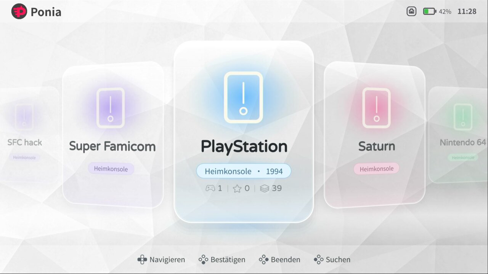

[Deutsch](README.de.md) · [English](README.md) · [Español](README.es.md) · [Français](README.fr.md) · [日本語](README.ja.md) · [Português](README.pt.md) · [Русский](README.ru.md) · [繁體中文](README.zh-TW.md) · [简体中文](README.zh-CN.md)

# PoniaEmu

**Ein Spiele-Launcher mit eigenem, eingebautem Emulator-Player. Kein RetroArch nötig.**



PoniaEmu ist eine modifizierte Version von [Pegasus Frontend](https://github.com/mmatyas/pegasus-frontend), portiert auf
Qt 6 und kombiniert mit **PoniaPlay**, einem von Grund auf neu geschriebenen kleinen Libretro-Player. Pegasus liefert die
Spielebibliothek und die Oberfläche (**PoniaFE**); PoniaPlay lädt Libretro-Cores (`.so`-Dateien) direkt. Zusammen ergeben sie
eine einzige, eigenständige Anwendung, die mehr als ein Dutzend Retro-Systeme abspielen kann, ohne dass RetroArch oder eine
andere Emulator-App installiert werden muss.

- **PoniaFE**: das Frontend. Pegasus Frontend, portiert auf Qt 6, mit Ponia-Branding, dem Macaron-Theme und einer Oberfläche in neun Sprachen.
- **PoniaPlay**: der eingebaute Player. Ein Libretro-Host (`src/libretro-host`), der die Cores als Shared Libraries ausführt,
  mit OpenGL-ES-Rendering, Zero-Copy-Videoausgabe, Gamepad-Hotkeys, Savestates und Unterstützung für ZIP/7z-ROMs.
- **Cores**: gewöhnliche Libretro-`.so`-Dateien. Kleine, freizügig lizenzierte Cores sind enthalten; die übrigen werden beim
  ersten Start eines Spiels heruntergeladen, das sie benötigt.

Die Oberfläche gibt es in neun Sprachen: English, 简体中文, 繁體中文, Español, Português, Русский, 日本語, Français und Deutsch.

## Unterstützte Systeme

| System | Core |
| --- | --- |
| Nintendo Entertainment System / Famicom | FCEUmm |
| Game Boy / Game Boy Color | Gambatte |
| Game Boy Advance | mGBA |
| Nintendo DS | melonDS |
| Super Nintendo / Super Famicom | Snes9x |
| Nintendo 64 | Mupen64Plus-Next |
| Nintendo GameCube (nur 64 Bit) | Dolphin |
| Sega Genesis / Mega Drive, Master System | Genesis Plus GX |
| Sega Saturn | YabaSanshiro |
| Sega Dreamcast | Flycast |
| NEC PC Engine / TurboGrafx-16 | Mednafen PCE Fast |
| Sony PlayStation | PCSX ReARMed |
| Sony PSP | PPSSPP |
| Neo Geo, CPS-1, CPS-2 und weitere FBNeo-Arcade-Sets | FBNeo |
| Arcade (MAME) | MAME, MAME 2003-Plus |
| Atari 2600 | Stella |
| Atari 5200 | a5200 |
| Atari 7800 | ProSystem |
| PICO-8 | fake-08, retro8 |
| Apple II | AppleWin |
| DOS | DOSBox Pure |

Hinweise:

- **Es sind keine Spiele und keine BIOS-Dateien enthalten.** Verwende deine eigenen, legal erworbenen ROMs. Manche Systeme
  (zum Beispiel Sega Saturn) benötigen eine BIOS-Datei, die in den Ordner `BIOS` neben deinen ROMs gehört.
- Cores mit nicht-kommerzieller Lizenz (Snes9x, Genesis Plus GX, FBNeo, MAME 2003-Plus) sind nie im Paket enthalten.
  PoniaEmu bietet an, sie bei der ersten Verwendung herunterzuladen.
- Hotkeys, Tastenbelegung und Pausenmenü verhalten sich auf jedem System gleich, weil sie von PoniaPlay verwaltet werden.

## Unterstützte Plattformen

| Plattform | Architekturen | Hinweise |
| --- | --- | --- |
| Android | 64 Bit (`arm64-v8a`), 32 Bit (`armeabi-v7a`) | Android 6.0 (API 23) oder neuer. Funktioniert mit Touchscreen, Gamepad oder TV-Fernbedienung. |
| Linux | 64 Bit, 32 Bit | Läuft unter X11, Wayland oder direkt auf dem Framebuffer (KMS/DRM). Die ausführbare Datei `poniaplay` wird neben dem Frontend installiert. |

Der GameCube-Core ist auf 32-Bit-ARM nicht verfügbar, weil Dolphin keinen ARM32-JIT hat.

## Steuerung

PoniaEmu behandelt jedes Gamepad immer als [Xbox-Pad](doc/img/pad-xbox-style.png), egal was auf den Tasten aufgedruckt ist:
Die untere Taste ist **A**, die rechte **B**, die linke **X** und die obere **Y**.

Die **Hotkey-Taste** ist **SELECT**. Halte sie gedrückt und drücke eine weitere Taste:

| Kombination | Aktion |
| --- | --- |
| Hotkey + START | Spiel beenden |
| Hotkey + R1 (rechte Schultertaste) | Savestate speichern |
| Hotkey + L1 (linke Schultertaste) | Savestate laden |
| Hotkey + X (links) | Auflösung durchschalten, 1X bis 4X |
| Hotkey + Y (oben) | FPS-Anzeige ein- oder ausblenden |
| Hotkey + R2 | Vorspulen |
| Hotkey + L2 | Zurückspulen |

## Kompilieren

PoniaEmu verwendet CMake. Du brauchst einen C++17-Compiler, CMake 3.16 oder neuer, Ninja und Qt **6.4 oder neuer** (Qt Quick,
Qt Quick Controls 2, Qt 5 Compatibility, Qt Multimedia, Qt Shader Tools) sowie SDL2. Qt 6.4.2 ist die Version, mit der entwickelt wird.

### Linux

```sh
git clone https://github.com/ponia2026/PoniaEmu.git
cd PoniaEmu
cmake -S . -B build -G Ninja -DCMAKE_BUILD_TYPE=Release
cmake --build build
sudo cmake --install build
```

Nützliche Optionen:

| Option | Standard | Bedeutung |
| --- | --- | --- |
| `PEGASUS_USE_SDL2_GAMEPAD` | `ON` | SDL2 für die Gamepad-Eingabe verwenden. |
| `PEGASUS_USE_SDL2_POWER` | `ON` (`OFF` unter Android) | SDL2 für Akkuinformationen verwenden. |
| `PEGASUS_ENABLE_LTO` | `ON` | Link-Time-Optimierung (langsamer zu bauen, schneller in der Ausführung). |
| `PEGASUS_STATIC_CXX` | `OFF` | Die C++-Laufzeit statisch linken. |

Für einen 32-Bit-Linux-Build konfigurierst du genauso, mit einer 32-Bit-Toolchain (oder auf einem 32-Bit-System).

### Android

Du brauchst das Qt-6.4.2-Android-Kit für jede gewünschte ABI (installierbar mit `aqtinstall`), Android NDK r25.1.8937393,
Android-SDK-Plattform 33 mit Build-Tools 33.0.2, JDK 17 und SDL2 (2.30.x), gebaut für dieselbe ABI.
Auf dem Build-Rechner muss außerdem das Qt-Desktop-Paket derselben Version installiert sein (es liefert `moc` und `rcc`).

```sh
export JAVA_HOME=/path/to/jdk17 ANDROID_HOME=/path/to/android-sdk
QT=/path/to/Qt/6.4.2/android_arm64_v8a      # für 32 Bit android_armv7 verwenden

# 1. Die mitgelieferten Libretro-Cores holen (für 32 Bit ABI=armeabi-v7a setzen und den passenden Ausgabeordner angeben)
etc/android/fetch-bundled-cores.sh

# 2. APK konfigurieren und bauen
cmake -S . -B build-android -G Ninja \
  -DCMAKE_TOOLCHAIN_FILE=$QT/lib/cmake/Qt6/qt.toolchain.cmake \
  -DQT_HOST_PATH=/usr \
  -DANDROID_ABI=arm64-v8a -DANDROID_PLATFORM=android-23 \
  -DSDL2_DIR=/path/to/sdl2-arm64/lib/cmake/SDL2 \
  -DCMAKE_FIND_ROOT_PATH=/path/to/sdl2-arm64
cmake --build build-android --target poniafe_make_apk

# 3. Optional: APK verkleinern, neu ausrichten und neu signieren
etc/android/repack-apk.sh <in.apk> <out.apk>
```

`etc/android/apk-name.sh` gibt den Dateinamen für einen Build aus, in der Form `PoniaEmu_v<Version>-<Datum>(<Commit>).apk`.
Für den PICO-8-Core `fake-08` gibt es keine fertige Android-Binärdatei; die Kommentare in `fetch-bundled-cores.sh` erklären, wie man ihn baut.

## Lizenz und Urheberrecht

Copyright (C) 2026 Equuleus Works.

- **PoniaFE** (das Frontend) ist ein abgeleitetes Werk von Pegasus Frontend, Copyright (C) 2017-2020 Mátyás Mustoha, und steht unter der
  **GNU General Public License v3.0 oder später**, mit den ergänzenden Bedingungen in [`LICENSE.md`](LICENSE.md).
  Die Urheberrechtsvermerke der ursprünglichen Quelldateien bleiben, wie von der Lizenz verlangt, erhalten.
- **PoniaPlay** (`src/libretro-host`) wurde von Grund auf neu geschrieben und steht unter **GPL-2.0-or-later**, damit es
  sowohl GPLv2-only- als auch GPLv3-Libretro-Cores laden kann. Es kommuniziert mit dem Frontend nur über Kommandozeilenargumente
  und Android-Intents. `libretro.h` steht unter der MIT-Lizenz, Copyright (C) 2010-2020 The RetroArch team.
- **Libretro-Cores** sind eigenständige Werke unter ihren eigenen Lizenzen. Enthalten sind nur Cores, deren Lizenz die
  kommerzielle Verbreitung erlaubt.
- Der Name „Ponia“ und das Ponia-Logo sind Eigentum von Equuleus Works. Siehe die Markenbedingungen in `LICENSE.md`.
- Alle anderen Marken, Produktnamen und Logos sind Eigentum ihrer jeweiligen Inhaber und dienen nur der Identifikation.
  Dieses Projekt ist unabhängig und weder mit den Autoren von Pegasus Frontend verbunden noch von ihnen unterstützt.

Die vollständige Liste der Komponenten und Lizenzen von Drittanbietern steht in [`NOTICE.md`](NOTICE.md).

## Danksagung

PoniaEmu steht auf den Schultern vieler Open-Source-Projekte. Vielen Dank an:

- [Pegasus Frontend](https://github.com/mmatyas/pegasus-frontend) von Mátyás Mustoha und den Mitwirkenden, die Grundlage des Frontends.
- [Libretro](https://github.com/libretro) und [RetroArch](https://github.com/libretro/RetroArch) für die Libretro-API
  und das Core-Ökosystem.
- Die Autoren und Betreuer der Cores:
  [FCEUmm](https://github.com/libretro/libretro-fceumm),
  [Gambatte](https://github.com/libretro/gambatte-libretro),
  [mGBA](https://github.com/mgba-emu/mgba),
  [melonDS](https://github.com/libretro/melonDS),
  [Snes9x](https://github.com/snes9xgit/snes9x),
  [Mupen64Plus-Next](https://github.com/libretro/mupen64plus-libretro-nx),
  [Dolphin](https://github.com/libretro/dolphin),
  [Genesis Plus GX](https://github.com/libretro/Genesis-Plus-GX),
  [YabaSanshiro](https://github.com/libretro/yabause),
  [Flycast](https://github.com/flyinghead/flycast),
  [Mednafen PCE Fast](https://github.com/libretro/beetle-pce-fast-libretro),
  [PCSX ReARMed](https://github.com/libretro/pcsx_rearmed),
  [PPSSPP](https://github.com/hrydgard/ppsspp),
  [FBNeo](https://github.com/libretro/FBNeo),
  [MAME](https://github.com/libretro/mame) und [MAME 2003-Plus](https://github.com/libretro/mame2003-plus-libretro),
  [Stella](https://github.com/stella-emu/stella),
  [a5200](https://github.com/libretro/a5200),
  [ProSystem](https://github.com/libretro/prosystem-libretro),
  [fake-08](https://github.com/jtothebell/fake-08),
  [retro8](https://github.com/libretro/retro8),
  [AppleWin](https://github.com/libretro/libretro-applewin) und
  [DOSBox Pure](https://github.com/schellingb/dosbox-pure).
- [Qt](https://www.qt.io/) und [SDL2](https://www.libsdl.org/).
- Die Schriften [Noto Sans](https://github.com/notofonts) und [Varela Round](https://fonts.google.com/specimen/Varela+Round)
  (SIL Open Font License 1.1) sowie Roboto (Apache License 2.0).
