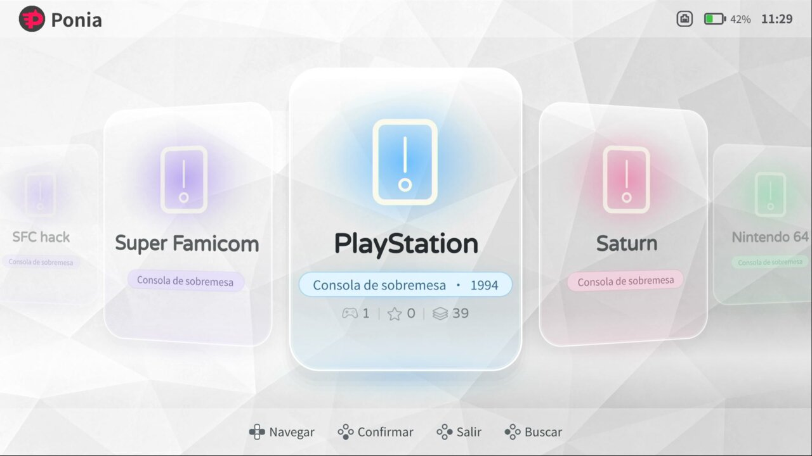

[Deutsch](README.de.md) · [English](README.md) · [Español](README.es.md) · [Français](README.fr.md) · [日本語](README.ja.md) · [Português](README.pt.md) · [Русский](README.ru.md) · [繁體中文](README.zh-TW.md) · [简体中文](README.zh-CN.md)

# PoniaEmu

**Un lanzador de juegos con su propio reproductor de emuladores integrado. No necesitas RetroArch.**



PoniaEmu es una versión modificada de [Pegasus Frontend](https://github.com/mmatyas/pegasus-frontend), portada a Qt 6 y
combinada con **PoniaPlay**, un pequeño reproductor Libretro escrito desde cero. Pegasus aporta la biblioteca de juegos y la
interfaz (**PoniaFE**); PoniaPlay carga directamente los núcleos Libretro (archivos `.so`). Juntos forman una única aplicación
independiente que puede ejecutar más de una docena de sistemas retro sin instalar RetroArch ni ninguna otra aplicación de emulador.

- **PoniaFE**: el frontend. Pegasus Frontend portado a Qt 6, con la marca Ponia, el tema Macaron y una interfaz en nueve idiomas.
- **PoniaPlay**: el reproductor integrado. Un host Libretro (`src/libretro-host`) que ejecuta los núcleos como bibliotecas compartidas,
  con renderizado OpenGL ES, salida de vídeo sin copias, atajos de mando, guardado de estado y soporte de ROM en ZIP/7z.
- **Núcleos**: archivos `.so` de Libretro normales. Se incluyen los núcleos pequeños y de licencia permisiva; el resto se descargan
  la primera vez que inicias un juego que los necesita.

La interfaz está disponible en nueve idiomas: English, 简体中文, 繁體中文, Español, Português, Русский, 日本語, Français y Deutsch.

## Sistemas compatibles

| Sistema | Núcleo |
| --- | --- |
| Nintendo Entertainment System / Famicom | FCEUmm |
| Game Boy / Game Boy Color | Gambatte |
| Game Boy Advance | mGBA |
| Nintendo DS | melonDS |
| Super Nintendo / Super Famicom | Snes9x |
| Nintendo 64 | Mupen64Plus-Next |
| Nintendo GameCube (solo 64 bits) | Dolphin |
| Sega Genesis / Mega Drive, Master System | Genesis Plus GX |
| Sega Saturn | YabaSanshiro |
| Sega Dreamcast | Flycast |
| NEC PC Engine / TurboGrafx-16 | Mednafen PCE Fast |
| Sony PlayStation | PCSX ReARMed |
| Sony PSP | PPSSPP |
| Neo Geo, CPS-1, CPS-2 y otros sets arcade de FBNeo | FBNeo |
| Arcade (MAME) | MAME, MAME 2003-Plus |
| Atari 2600 | Stella |
| Atari 5200 | a5200 |
| Atari 7800 | ProSystem |
| PICO-8 | fake-08, retro8 |
| Apple II | AppleWin |
| DOS | DOSBox Pure |

Notas:

- **No se incluyen juegos ni archivos BIOS.** Usa tus propias ROM obtenidas legalmente. Algunos sistemas (por ejemplo, Sega Saturn)
  necesitan un archivo BIOS, que va en la carpeta `BIOS` junto a tus ROM.
- Los núcleos con licencia no comercial (Snes9x, Genesis Plus GX, FBNeo, MAME 2003-Plus) nunca se incluyen en el paquete.
  PoniaEmu te ofrece descargarlos la primera vez que se usan.
- Los atajos, la distribución de botones y el menú de pausa se comportan igual en todos los sistemas, porque los gestiona PoniaPlay.

## Plataformas compatibles

| Plataforma | Arquitecturas | Notas |
| --- | --- | --- |
| Android | ARM de 64 bits (`arm64-v8a`), ARM de 32 bits (`armeabi-v7a`) | Android 6.0 (API 23) o posterior. Funciona con pantalla táctil, mando o mando a distancia de TV. |
| Linux | x86_64 (PC de 64 bits), ARM de 64 bits (`arm64`), ARM de 32 bits (`armhf`) | Funciona en X11, Wayland o directamente sobre el framebuffer (KMS/DRM). El ejecutable `poniaplay` se instala junto al frontend. |

El núcleo de GameCube no está disponible en ARM de 32 bits, porque Dolphin no tiene JIT para ARM32.

## Controles

PoniaEmu siempre trata el mando como un [mando estilo Xbox](doc/img/pad-xbox-style.png), sin importar lo que lleven impreso los botones:
el botón de abajo es **A**, el de la derecha **B**, el de la izquierda **X** y el de arriba **Y**.

La **tecla rápida** es el botón **SELECT**. Mantenla pulsada y pulsa otro botón:

| Combinación | Acción |
| --- | --- |
| Tecla rápida + START | Salir del juego |
| Tecla rápida + R1 (gatillo superior derecho) | Guardar un estado |
| Tecla rápida + L1 (gatillo superior izquierdo) | Cargar un estado |
| Tecla rápida + X (izquierda) | Cambiar la resolución de 1X a 4X, en ciclo |
| Tecla rápida + Y (arriba) | Mostrar u ocultar los FPS |
| Tecla rápida + R2 | Avance rápido |
| Tecla rápida + L2 | Rebobinar |

## Compilación

PoniaEmu usa CMake. Necesitas un compilador C++17, CMake 3.16 o posterior, Ninja y Qt **6.4 o posterior** (Qt Quick, Qt Quick
Controls 2, Qt 5 Compatibility, Qt Multimedia, Qt Shader Tools), además de SDL2. Qt 6.4.2 es la versión usada en el desarrollo.

### Linux

```sh
git clone https://github.com/ponia2026/PoniaEmu.git
cd PoniaEmu
cmake -S . -B build -G Ninja -DCMAKE_BUILD_TYPE=Release
cmake --build build
sudo cmake --install build
```

Opciones útiles:

| Opción | Predeterminado | Significado |
| --- | --- | --- |
| `PEGASUS_USE_SDL2_GAMEPAD` | `ON` | Usar SDL2 para la entrada del mando. |
| `PEGASUS_USE_SDL2_POWER` | `ON` (`OFF` en Android) | Usar SDL2 para la información de batería. |
| `PEGASUS_ENABLE_LTO` | `ON` | Optimización en tiempo de enlace (compila más lento, se ejecuta más rápido). |
| `PEGASUS_STATIC_CXX` | `OFF` | Enlazar estáticamente el runtime de C++. |

Para ARM (`arm64` o `armhf`), configura de la misma forma con un archivo de cadena de herramientas de compilación cruzada para el destino, o compila en el propio dispositivo.

### Android

Necesitas el kit de Android de Qt 6.4.2 para cada ABI que quieras (se instala con `aqtinstall`), Android NDK r25.1.8937393,
la plataforma 33 del SDK de Android con build-tools 33.0.2, JDK 17 y SDL2 (2.30.x) compilado para la misma ABI.
En la máquina de compilación debe estar instalado el Qt de escritorio de la misma versión (aporta `moc` y `rcc`).

```sh
export JAVA_HOME=/path/to/jdk17 ANDROID_HOME=/path/to/android-sdk
QT=/path/to/Qt/6.4.2/android_arm64_v8a      # usa android_armv7 para 32 bits

# 1. Obtener los núcleos Libretro incluidos (para 32 bits usa ABI=armeabi-v7a e indica la carpeta de salida correspondiente)
etc/android/fetch-bundled-cores.sh

# 2. Configurar y compilar el APK
cmake -S . -B build-android -G Ninja \
  -DCMAKE_TOOLCHAIN_FILE=$QT/lib/cmake/Qt6/qt.toolchain.cmake \
  -DQT_HOST_PATH=/usr \
  -DANDROID_ABI=arm64-v8a -DANDROID_PLATFORM=android-23 \
  -DSDL2_DIR=/path/to/sdl2-arm64/lib/cmake/SDL2 \
  -DCMAKE_FIND_ROOT_PATH=/path/to/sdl2-arm64
cmake --build build-android --target poniafe_make_apk

# 3. Opcional: reducir, realinear y volver a firmar el APK
etc/android/repack-apk.sh <in.apk> <out.apk>
```

`etc/android/apk-name.sh` muestra el nombre de archivo de una compilación, con el formato `PoniaEmu_v<versión>-<fecha>(<commit>).apk`.
El núcleo de PICO-8 `fake-08` no tiene binario precompilado para Android; los comentarios de `fetch-bundled-cores.sh` explican cómo compilarlo.

## Licencia y derechos de autor

Copyright (C) 2026 Equuleus Works.

- **PoniaFE** (el frontend) es una obra derivada de Pegasus Frontend, Copyright (C) 2017-2020 Mátyás Mustoha, y se distribuye bajo la
  **Licencia Pública General de GNU v3.0 o posterior**, con los términos suplementarios de [`LICENSE.md`](LICENSE.md).
  Los avisos de derechos de autor de los archivos fuente originales se conservan, como exige la licencia.
- **PoniaPlay** (`src/libretro-host`) se escribió desde cero y se distribuye bajo **GPL-2.0-or-later**, de modo que puede cargar
  tanto núcleos Libretro GPLv2-only como GPLv3. Solo se comunica con el frontend mediante argumentos de línea de comandos
  e Intents de Android. `libretro.h` tiene licencia MIT, Copyright (C) 2010-2020 The RetroArch team.
- Los **núcleos Libretro** son obras independientes con sus propias licencias. Solo se incluyen los núcleos cuyas licencias permiten
  la distribución comercial.
- El nombre «Ponia» y el logotipo de Ponia son propiedad de Equuleus Works. Consulta los términos de marca en `LICENSE.md`.
- El resto de marcas, nombres de producto y logotipos son propiedad de sus respectivos dueños y se usan solo para identificación.
  Este proyecto es independiente y no está afiliado ni respaldado por los autores de Pegasus Frontend.

La lista completa de componentes y licencias de terceros está en [`NOTICE.md`](NOTICE.md).

## Agradecimientos

PoniaEmu se apoya en muchos proyectos de código abierto. Gracias a:

- [Pegasus Frontend](https://github.com/mmatyas/pegasus-frontend) de Mátyás Mustoha y colaboradores, la base del frontend.
- [Libretro](https://github.com/libretro) y [RetroArch](https://github.com/libretro/RetroArch) por la API de Libretro
  y el ecosistema de núcleos.
- Los autores y mantenedores de los núcleos:
  [FCEUmm](https://github.com/libretro/libretro-fceumm),
  [Gambatte](https://github.com/libretro/gambatte-libretro),
  [mGBA](https://github.com/mgba-emu/mgba),
  [melonDS](https://github.com/libretro/melonDS),
  [Snes9x](https://github.com/snes9xgit/snes9x),
  [Mupen64Plus-Next](https://github.com/libretro/mupen64plus-libretro-nx),
  [Dolphin](https://github.com/libretro/dolphin),
  [Genesis Plus GX](https://github.com/libretro/Genesis-Plus-GX),
  [YabaSanshiro](https://github.com/libretro/yabause),
  [Flycast](https://github.com/flyinghead/flycast),
  [Mednafen PCE Fast](https://github.com/libretro/beetle-pce-fast-libretro),
  [PCSX ReARMed](https://github.com/libretro/pcsx_rearmed),
  [PPSSPP](https://github.com/hrydgard/ppsspp),
  [FBNeo](https://github.com/libretro/FBNeo),
  [MAME](https://github.com/libretro/mame) y [MAME 2003-Plus](https://github.com/libretro/mame2003-plus-libretro),
  [Stella](https://github.com/stella-emu/stella),
  [a5200](https://github.com/libretro/a5200),
  [ProSystem](https://github.com/libretro/prosystem-libretro),
  [fake-08](https://github.com/jtothebell/fake-08),
  [retro8](https://github.com/libretro/retro8),
  [AppleWin](https://github.com/libretro/libretro-applewin) y
  [DOSBox Pure](https://github.com/schellingb/dosbox-pure).
- [Qt](https://www.qt.io/) y [SDL2](https://www.libsdl.org/).
- Las fuentes [Noto Sans](https://github.com/notofonts) y [Varela Round](https://fonts.google.com/specimen/Varela+Round)
  (SIL Open Font License 1.1) y Roboto (Apache License 2.0).
