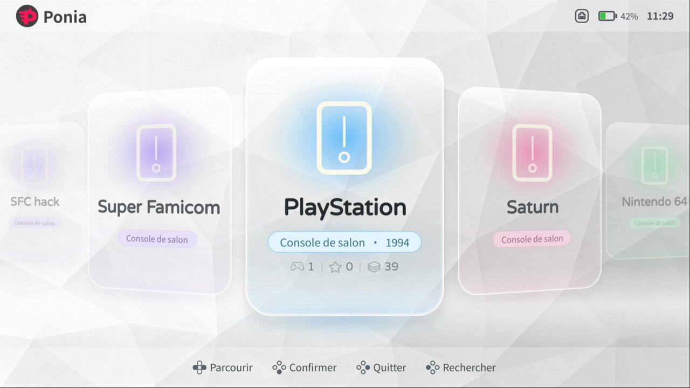

[Deutsch](README.de.md) · [English](README.md) · [Español](README.es.md) · [Français](README.fr.md) · [日本語](README.ja.md) · [Português](README.pt.md) · [Русский](README.ru.md) · [繁體中文](README.zh-TW.md) · [简体中文](README.zh-CN.md)

# PoniaEmu

**Un lanceur de jeux avec son propre lecteur d'émulateurs intégré. RetroArch n'est pas nécessaire.**



PoniaEmu est une version modifiée de [Pegasus Frontend](https://github.com/mmatyas/pegasus-frontend), portée vers Qt 6 et
associée à **PoniaPlay**, un petit lecteur Libretro écrit de zéro. Pegasus fournit la bibliothèque de jeux et l'interface
(**PoniaFE**) ; PoniaPlay charge directement les cœurs Libretro (fichiers `.so`). Ensemble, ils forment une seule application
autonome capable de faire tourner plus d'une douzaine de systèmes rétro, sans installer RetroArch ni aucune autre application d'émulation.

- **PoniaFE** : le frontend. Pegasus Frontend porté vers Qt 6, avec l'habillage Ponia, le thème Macaron et une interface en neuf langues.
- **PoniaPlay** : le lecteur intégré. Un hôte Libretro (`src/libretro-host`) qui exécute les cœurs comme bibliothèques partagées,
  avec rendu OpenGL ES, sortie vidéo sans copie, raccourcis de manette, sauvegardes d'état et prise en charge des ROM ZIP/7z.
- **Cœurs** : de simples fichiers `.so` Libretro. Les petits cœurs sous licence permissive sont inclus ; les autres sont téléchargés
  au premier lancement d'un jeu qui en a besoin.

L'interface est disponible en neuf langues : English, 简体中文, 繁體中文, Español, Português, Русский, 日本語, Français et Deutsch.

## Systèmes pris en charge

| Système | Cœur |
| --- | --- |
| Nintendo Entertainment System / Famicom | FCEUmm |
| Game Boy / Game Boy Color | Gambatte |
| Game Boy Advance | mGBA |
| Nintendo DS | melonDS |
| Super Nintendo / Super Famicom | Snes9x |
| Nintendo 64 | Mupen64Plus-Next |
| Nintendo GameCube (64 bits uniquement) | Dolphin |
| Sega Genesis / Mega Drive, Master System | Genesis Plus GX |
| Sega Saturn | YabaSanshiro |
| Sega Dreamcast | Flycast |
| NEC PC Engine / TurboGrafx-16 | Mednafen PCE Fast |
| Sony PlayStation | PCSX ReARMed |
| Sony PSP | PPSSPP |
| Neo Geo, CPS-1, CPS-2 et autres jeux d'arcade FBNeo | FBNeo |
| Arcade (MAME) | MAME, MAME 2003-Plus |
| Atari 2600 | Stella |
| Atari 5200 | a5200 |
| Atari 7800 | ProSystem |
| PICO-8 | fake-08, retro8 |
| Apple II | AppleWin |
| DOS | DOSBox Pure |

Remarques :

- **Aucun jeu ni fichier BIOS n'est fourni.** Utilisez vos propres ROM, obtenues légalement. Certains systèmes (par exemple la Sega Saturn)
  nécessitent un fichier BIOS, à placer dans le dossier `BIOS` à côté de vos ROM.
- Les cœurs sous licence non commerciale (Snes9x, Genesis Plus GX, FBNeo, MAME 2003-Plus) ne sont jamais inclus dans le paquet.
  PoniaEmu propose de les télécharger à la première utilisation.
- Les raccourcis, la disposition des boutons et le menu pause se comportent de la même façon sur tous les systèmes, car ils sont gérés par PoniaPlay.

## Plateformes prises en charge

| Plateforme | Architectures | Remarques |
| --- | --- | --- |
| Android | ARM 64 bits (`arm64-v8a`), ARM 32 bits (`armeabi-v7a`) | Android 6.0 (API 23) ou plus récent. Fonctionne avec un écran tactile, une manette ou une télécommande de TV. |
| Linux | x86_64 (PC 64 bits), ARM 64 bits (`arm64`), ARM 32 bits (`armhf`) | Fonctionne sous X11, Wayland ou directement sur le framebuffer (KMS/DRM). L'exécutable `poniaplay` est installé à côté du frontend. |

Le cœur GameCube n'est pas disponible sur ARM 32 bits, car Dolphin n'a pas de JIT ARM32.

## Commandes

PoniaEmu traite toujours une manette comme une [manette de style Xbox](doc/img/pad-xbox-style.png), quoi qu'il soit imprimé sur les boutons :
le bouton du bas est **A**, celui de droite **B**, celui de gauche **X** et celui du haut **Y**.

La **touche de raccourci** est le bouton **SELECT**. Maintenez-la et appuyez sur un autre bouton :

| Combinaison | Action |
| --- | --- |
| Raccourci + START | Quitter le jeu |
| Raccourci + R1 (gâchette supérieure droite) | Sauvegarder un état |
| Raccourci + L1 (gâchette supérieure gauche) | Charger un état |
| Raccourci + X (gauche) | Faire défiler la résolution de 1X à 4X |
| Raccourci + Y (haut) | Afficher ou masquer les FPS |
| Raccourci + R2 | Avance rapide |
| Raccourci + L2 | Retour en arrière |

## Compilation

PoniaEmu utilise CMake. Il faut un compilateur C++17, CMake 3.16 ou plus récent, Ninja, et Qt **6.4 ou plus récent** (Qt Quick, Qt Quick
Controls 2, Qt 5 Compatibility, Qt Multimedia, Qt Shader Tools), ainsi que SDL2. Qt 6.4.2 est la version utilisée pour le développement.

### Linux

```sh
git clone https://github.com/ponia2026/PoniaEmu.git
cd PoniaEmu
cmake -S . -B build -G Ninja -DCMAKE_BUILD_TYPE=Release
cmake --build build
sudo cmake --install build
```

Options utiles :

| Option | Par défaut | Signification |
| --- | --- | --- |
| `PEGASUS_USE_SDL2_GAMEPAD` | `ON` | Utiliser SDL2 pour la manette. |
| `PEGASUS_USE_SDL2_POWER` | `ON` (`OFF` sous Android) | Utiliser SDL2 pour les informations de batterie. |
| `PEGASUS_ENABLE_LTO` | `ON` | Optimisation à l'édition de liens (compilation plus lente, exécution plus rapide). |
| `PEGASUS_STATIC_CXX` | `OFF` | Lier statiquement le runtime C++. |

Pour ARM (`arm64` ou `armhf`), configurez de la même manière avec un fichier de chaîne d'outils de compilation croisée pour la cible, ou compilez directement sur l'appareil.

### Android

Il faut le kit Android de Qt 6.4.2 pour chaque ABI voulue (installable avec `aqtinstall`), Android NDK r25.1.8937393,
la plateforme 33 du SDK Android avec build-tools 33.0.2, JDK 17 et SDL2 (2.30.x) compilé pour la même ABI.
Le Qt de bureau de la même version doit être installé sur la machine de compilation (il fournit `moc` et `rcc`).

```sh
export JAVA_HOME=/path/to/jdk17 ANDROID_HOME=/path/to/android-sdk
QT=/path/to/Qt/6.4.2/android_arm64_v8a      # utilisez android_armv7 pour le 32 bits

# 1. Récupérer les cœurs Libretro inclus (pour le 32 bits : ABI=armeabi-v7a, et indiquer le dossier de sortie correspondant)
etc/android/fetch-bundled-cores.sh

# 2. Configurer et compiler l'APK
cmake -S . -B build-android -G Ninja \
  -DCMAKE_TOOLCHAIN_FILE=$QT/lib/cmake/Qt6/qt.toolchain.cmake \
  -DQT_HOST_PATH=/usr \
  -DANDROID_ABI=arm64-v8a -DANDROID_PLATFORM=android-23 \
  -DSDL2_DIR=/path/to/sdl2-arm64/lib/cmake/SDL2 \
  -DCMAKE_FIND_ROOT_PATH=/path/to/sdl2-arm64
cmake --build build-android --target poniaemu_make_apk

# 3. Facultatif : réduire, réaligner et re-signer l'APK
etc/android/repack-apk.sh <in.apk> <out.apk>
```

`etc/android/apk-name.sh` affiche le nom de fichier d'une compilation, sous la forme `PoniaEmu_v<version>-<date>(<commit>).apk`.
Le cœur PICO-8 `fake-08` n'a pas de binaire Android précompilé ; les commentaires de `fetch-bundled-cores.sh` expliquent comment le compiler.

## Licence et droit d'auteur

Copyright (C) 2026 Equuleus Works.

- **PoniaFE** (le frontend) est une œuvre dérivée de Pegasus Frontend, Copyright (C) 2017-2020 Mátyás Mustoha, et est distribué sous la
  **licence publique générale GNU v3.0 ou ultérieure**, avec les conditions supplémentaires de [`LICENSE.md`](LICENSE.md).
  Les mentions de droit d'auteur des fichiers sources d'origine sont conservées, comme l'exige la licence.
- **PoniaPlay** (`src/libretro-host`) a été écrit de zéro et est distribué sous **GPL-2.0-or-later**, afin de pouvoir charger
  aussi bien les cœurs Libretro GPLv2 uniquement que GPLv3. Il ne communique avec le frontend que par arguments de ligne de commande
  et Intents Android. `libretro.h` est sous licence MIT, Copyright (C) 2010-2020 The RetroArch team.
- Les **cœurs Libretro** sont des œuvres distinctes, sous leurs propres licences. Seuls les cœurs dont la licence autorise
  la distribution commerciale sont inclus.
- Le nom « Ponia » et le logo Ponia sont la propriété d'Equuleus Works. Voir les conditions relatives aux marques dans `LICENSE.md`.
- Toutes les autres marques, noms de produits et logos appartiennent à leurs propriétaires respectifs et ne sont utilisés qu'à des fins d'identification.
  Ce projet est indépendant et n'est ni affilié aux auteurs de Pegasus Frontend ni approuvé par eux.

La liste complète des composants tiers et de leurs licences se trouve dans [`NOTICE.md`](NOTICE.md).

## Remerciements

PoniaEmu repose sur de nombreux projets open source. Merci à :

- [Pegasus Frontend](https://github.com/mmatyas/pegasus-frontend) de Mátyás Mustoha et des contributeurs, la base du frontend.
- [Libretro](https://github.com/libretro) et [RetroArch](https://github.com/libretro/RetroArch) pour l'API Libretro
  et l'écosystème de cœurs.
- Les auteurs et mainteneurs des cœurs :
  [FCEUmm](https://github.com/libretro/libretro-fceumm),
  [Gambatte](https://github.com/libretro/gambatte-libretro),
  [mGBA](https://github.com/mgba-emu/mgba),
  [melonDS](https://github.com/libretro/melonDS),
  [Snes9x](https://github.com/snes9xgit/snes9x),
  [Mupen64Plus-Next](https://github.com/libretro/mupen64plus-libretro-nx),
  [Dolphin](https://github.com/libretro/dolphin),
  [Genesis Plus GX](https://github.com/libretro/Genesis-Plus-GX),
  [YabaSanshiro](https://github.com/libretro/yabause),
  [Flycast](https://github.com/flyinghead/flycast),
  [Mednafen PCE Fast](https://github.com/libretro/beetle-pce-fast-libretro),
  [PCSX ReARMed](https://github.com/libretro/pcsx_rearmed),
  [PPSSPP](https://github.com/hrydgard/ppsspp),
  [FBNeo](https://github.com/libretro/FBNeo),
  [MAME](https://github.com/libretro/mame) et [MAME 2003-Plus](https://github.com/libretro/mame2003-plus-libretro),
  [Stella](https://github.com/stella-emu/stella),
  [a5200](https://github.com/libretro/a5200),
  [ProSystem](https://github.com/libretro/prosystem-libretro),
  [fake-08](https://github.com/jtothebell/fake-08),
  [retro8](https://github.com/libretro/retro8),
  [AppleWin](https://github.com/libretro/libretro-applewin) et
  [DOSBox Pure](https://github.com/schellingb/dosbox-pure).
- [Qt](https://www.qt.io/) et [SDL2](https://www.libsdl.org/).
- Les polices [Noto Sans](https://github.com/notofonts) et [Varela Round](https://fonts.google.com/specimen/Varela+Round)
  (SIL Open Font License 1.1) et Roboto (Apache License 2.0).
