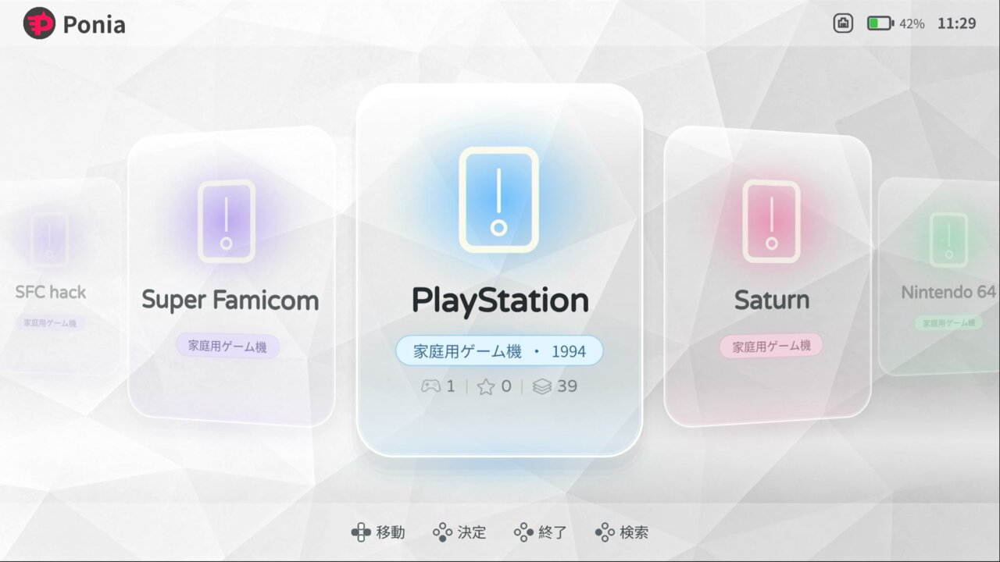

[Deutsch](README.de.md) · [English](README.md) · [Español](README.es.md) · [Français](README.fr.md) · [日本語](README.ja.md) · [Português](README.pt.md) · [Русский](README.ru.md) · [繁體中文](README.zh-TW.md) · [简体中文](README.zh-CN.md)

# PoniaEmu

**エミュレーター再生機能を内蔵したゲームランチャー。RetroArch は不要です。**



PoniaEmu は [Pegasus Frontend](https://github.com/mmatyas/pegasus-frontend) を Qt 6 に移植して改造したもので、
ゼロから書き起こした小型の Libretro プレーヤー **PoniaPlay** と組み合わせています。Pegasus がゲームライブラリと
画面 (**PoniaFE**) を担当し、PoniaPlay が Libretro コア (`.so` ファイル) を直接読み込みます。この 2 つで 1 つの独立した
アプリになり、RetroArch などのエミュレーターアプリを入れなくても、十数種類のレトロ機種を遊べます。

- **PoniaFE**: フロントエンド。Qt 6 に移植した Pegasus Frontend に、Ponia のブランド、Macaron テーマ、9 言語の画面を加えたものです。
- **PoniaPlay**: 内蔵プレーヤー。Libretro ホスト (`src/libretro-host`) で、コアを共有ライブラリとして実行します。
  OpenGL ES 描画、ゼロコピーの映像出力、ゲームパッドのホットキー、ステートセーブ、ZIP/7z の ROM に対応しています。
- **コア**: 通常の Libretro `.so` ファイルです。小さくて寛容なライセンスのコアは同梱し、それ以外は、必要なゲームを
  初めて起動したときにダウンロードします。

画面は 9 言語に対応しています: English、简体中文、繁體中文、Español、Português、Русский、日本語、Français、Deutsch。

## 対応機種

| 機種 | コア |
| --- | --- |
| ファミリーコンピュータ / NES | FCEUmm |
| ゲームボーイ / ゲームボーイカラー | Gambatte |
| ゲームボーイアドバンス | mGBA |
| ニンテンドーDS | melonDS |
| スーパーファミコン / SNES | Snes9x |
| NINTENDO64 | Mupen64Plus-Next |
| ニンテンドーゲームキューブ (64 ビットのみ) | Dolphin |
| メガドライブ / Genesis、マスターシステム | Genesis Plus GX |
| セガサターン | YabaSanshiro |
| ドリームキャスト | Flycast |
| PCエンジン / TurboGrafx-16 | Mednafen PCE Fast |
| プレイステーション | PCSX ReARMed |
| PSP | PPSSPP |
| ネオジオ、CPS-1、CPS-2 などの FBNeo アーケード | FBNeo |
| アーケード (MAME) | MAME, MAME 2003-Plus |
| Atari 2600 | Stella |
| Atari 5200 | a5200 |
| Atari 7800 | ProSystem |
| PICO-8 | fake-08, retro8 |
| Apple II | AppleWin |
| DOS | DOSBox Pure |

注意:

- **ゲームや BIOS ファイルは含まれていません。** 合法的に入手した ROM をご用意ください。一部の機種 (たとえばセガサターン) は
  BIOS ファイルが必要で、ROM と同じ場所の `BIOS` フォルダーに置きます。
- 非商用ライセンスのコア (Snes9x、Genesis Plus GX、FBNeo、MAME 2003-Plus) は、パッケージには同梱しません。
  初めて使うときに、PoniaEmu がダウンロードを案内します。
- ホットキー、ボタン配置、ポーズメニューは PoniaPlay が処理するため、どの機種でも同じ動作になります。

## 対応プラットフォーム

| プラットフォーム | アーキテクチャ | 備考 |
| --- | --- | --- |
| Android | ARM 64 ビット (`arm64-v8a`)、ARM 32 ビット (`armeabi-v7a`) | Android 6.0 (API 23) 以降。タッチ画面、ゲームパッド、テレビのリモコンで操作できます。 |
| Linux | x86_64 (64 ビット PC)、ARM 64 ビット (`arm64`)、ARM 32 ビット (`armhf`) | X11、Wayland、またはフレームバッファ (KMS/DRM) 上で直接動作します。`poniaplay` 実行ファイルはフロントエンドと同じ場所にインストールされます。 |

Dolphin には ARM32 向けの JIT がないため、32 ビット ARM では GameCube のコアは使えません。

## 操作

PoniaEmu は、ボタンに何と印刷されていても、ゲームパッドを常に [Xbox 式のパッド](doc/img/pad-xbox-style.png) として扱います。
下のボタンが **A**、右が **B**、左が **X**、上が **Y** です。

**ホットキー**は **SELECT** ボタンです。押したままほかのボタンを押します。

| 組み合わせ | 動作 |
| --- | --- |
| ホットキー + START | ゲームを終了 |
| ホットキー + R1（右ショルダー） | ステートセーブ |
| ホットキー + L1（左ショルダー） | ステートロード |
| ホットキー + X（左） | 解像度を 1X～4X で切り替え（循環） |
| ホットキー + Y（上） | FPS 表示の切り替え |
| ホットキー + R2 | 早送り |
| ホットキー + L2 | 巻き戻し |

## ビルド

PoniaEmu は CMake を使います。C++17 コンパイラ、CMake 3.16 以降、Ninja、Qt **6.4 以降** (Qt Quick、Qt Quick Controls 2、
Qt 5 Compatibility、Qt Multimedia、Qt Shader Tools)、そして SDL2 が必要です。開発に使っているのは Qt 6.4.2 です。

### Linux

```sh
git clone https://github.com/ponia2026/PoniaEmu.git
cd PoniaEmu
cmake -S . -B build -G Ninja -DCMAKE_BUILD_TYPE=Release
cmake --build build
sudo cmake --install build
```

主なオプション:

| オプション | 既定値 | 内容 |
| --- | --- | --- |
| `PEGASUS_USE_SDL2_GAMEPAD` | `ON` | ゲームパッド入力に SDL2 を使います。 |
| `PEGASUS_USE_SDL2_POWER` | `ON` (Android では `OFF`) | バッテリー情報に SDL2 を使います。 |
| `PEGASUS_ENABLE_LTO` | `ON` | リンク時最適化 (ビルドは遅くなりますが、実行は速くなります)。 |
| `PEGASUS_STATIC_CXX` | `OFF` | C++ ランタイムを静的にリンクします。 |

ARM (`arm64` または `armhf`) 向けは、同じ手順で、対象向けのクロスコンパイル用ツールチェーンファイルを指定するか、機器上で直接ビルドします。

### Android

ビルドしたい ABI ごとに Qt 6.4.2 の Android キット (`aqtinstall` でインストールできます)、Android NDK r25.1.8937393、
Android SDK プラットフォーム 33 と build-tools 33.0.2、JDK 17、同じ ABI 向けにビルドした SDL2 (2.30.x) が必要です。
ビルドするマシンには、同じバージョンのデスクトップ版 Qt も必要です (`moc` と `rcc` を提供します)。

```sh
export JAVA_HOME=/path/to/jdk17 ANDROID_HOME=/path/to/android-sdk
QT=/path/to/Qt/6.4.2/android_arm64_v8a      # 32 ビットは android_armv7 を使います

# 1. 同梱の Libretro コアを取得します (32 ビットは ABI=armeabi-v7a にして、対応する出力フォルダーを指定します)
etc/android/fetch-bundled-cores.sh

# 2. APK を構成してビルドします
cmake -S . -B build-android -G Ninja \
  -DCMAKE_TOOLCHAIN_FILE=$QT/lib/cmake/Qt6/qt.toolchain.cmake \
  -DQT_HOST_PATH=/usr \
  -DANDROID_ABI=arm64-v8a -DANDROID_PLATFORM=android-23 \
  -DSDL2_DIR=/path/to/sdl2-arm64/lib/cmake/SDL2 \
  -DCMAKE_FIND_ROOT_PATH=/path/to/sdl2-arm64
cmake --build build-android --target poniafe_make_apk

# 3. 任意: APK を縮小し、再アライメントして再署名します
etc/android/repack-apk.sh <in.apk> <out.apk>
```

`etc/android/apk-name.sh` は、ビルドごとのファイル名を `PoniaEmu_v<バージョン>-<日付>(<コミット>).apk` の形式で表示します。
PICO-8 のコア `fake-08` には Android 用のビルド済みバイナリがありません。ビルド方法は `fetch-bundled-cores.sh` のコメントに書かれています。

## ライセンスと著作権

Copyright (C) 2026 Equuleus Works.

- **PoniaFE** (フロントエンド) は、Pegasus Frontend (Copyright (C) 2017-2020 Mátyás Mustoha) の派生物で、
  **GNU General Public License v3.0 以降** のもとで提供されます。補足条件は [`LICENSE.md`](LICENSE.md) にあります。
  元のソースファイルの著作権表示は、ライセンスの要求どおり残しています。
- **PoniaPlay** (`src/libretro-host`) はゼロから書かれ、**GPL-2.0-or-later** で提供されます。これにより、GPLv2 のみのコアも
  GPLv3 のコアも読み込めます。フロントエンドとはコマンドライン引数と Android の Intent だけでやり取りします。
  `libretro.h` は MIT ライセンスで、Copyright (C) 2010-2020 The RetroArch team です。
- **Libretro コア** は、それぞれ独自のライセンスを持つ別の著作物です。商用配布が認められているライセンスのコアだけを同梱しています。
- 「Ponia」という名称と Ponia のロゴは Equuleus Works の所有物です。商標に関する条件は `LICENSE.md` をご覧ください。
- そのほかの商標、製品名、ロゴは、それぞれの所有者に帰属し、識別のためだけに使用しています。
  このプロジェクトは独立したもので、Pegasus Frontend の作者とは無関係であり、承認も受けていません。

サードパーティのコンポーネントとライセンスの一覧は [`NOTICE.md`](NOTICE.md) にあります。

## 謝辞

PoniaEmu は多くのオープンソースプロジェクトの上に成り立っています。次の皆さまに感謝します。

- [Pegasus Frontend](https://github.com/mmatyas/pegasus-frontend): Mátyás Mustoha さんと貢献者の皆さん。フロントエンドの土台です。
- [Libretro](https://github.com/libretro) と [RetroArch](https://github.com/libretro/RetroArch): Libretro API とコアのエコシステム。
- コアの作者とメンテナーの皆さん:
  [FCEUmm](https://github.com/libretro/libretro-fceumm)、
  [Gambatte](https://github.com/libretro/gambatte-libretro)、
  [mGBA](https://github.com/mgba-emu/mgba)、
  [melonDS](https://github.com/libretro/melonDS)、
  [Snes9x](https://github.com/snes9xgit/snes9x)、
  [Mupen64Plus-Next](https://github.com/libretro/mupen64plus-libretro-nx)、
  [Dolphin](https://github.com/libretro/dolphin)、
  [Genesis Plus GX](https://github.com/libretro/Genesis-Plus-GX)、
  [YabaSanshiro](https://github.com/libretro/yabause)、
  [Flycast](https://github.com/flyinghead/flycast)、
  [Mednafen PCE Fast](https://github.com/libretro/beetle-pce-fast-libretro)、
  [PCSX ReARMed](https://github.com/libretro/pcsx_rearmed)、
  [PPSSPP](https://github.com/hrydgard/ppsspp)、
  [FBNeo](https://github.com/libretro/FBNeo)、
  [MAME](https://github.com/libretro/mame) と [MAME 2003-Plus](https://github.com/libretro/mame2003-plus-libretro)、
  [Stella](https://github.com/stella-emu/stella)、
  [a5200](https://github.com/libretro/a5200)、
  [ProSystem](https://github.com/libretro/prosystem-libretro)、
  [fake-08](https://github.com/jtothebell/fake-08)、
  [retro8](https://github.com/libretro/retro8)、
  [AppleWin](https://github.com/libretro/libretro-applewin)、
  [DOSBox Pure](https://github.com/schellingb/dosbox-pure)。
- [Qt](https://www.qt.io/) と [SDL2](https://www.libsdl.org/)。
- フォントの [Noto Sans](https://github.com/notofonts) と [Varela Round](https://fonts.google.com/specimen/Varela+Round)
  (SIL Open Font License 1.1)、および Roboto (Apache License 2.0)。
