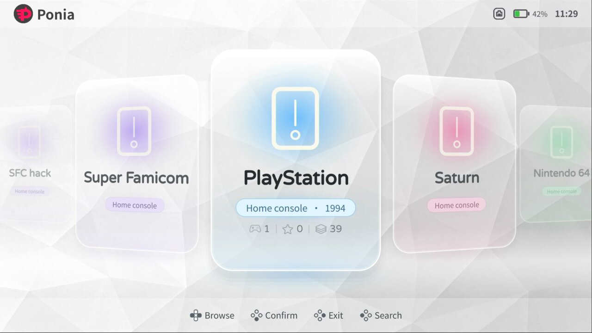

[Deutsch](README.de.md) · [English](README.md) · [Español](README.es.md) · [Français](README.fr.md) · [日本語](README.ja.md) · [Português](README.pt.md) · [Русский](README.ru.md) · [繁體中文](README.zh-TW.md) · [简体中文](README.zh-CN.md)

# PoniaEmu

**A game launcher with its own built-in emulator player. No RetroArch required.**



PoniaEmu is a modified version of [Pegasus Frontend](https://github.com/mmatyas/pegasus-frontend), ported to Qt 6 and
combined with **PoniaPlay**, a small Libretro player written from scratch. Pegasus provides the game library and the
interface (**PoniaFE**); PoniaPlay loads Libretro cores (`.so` files) directly. Together they form a single, standalone
application that can play more than a dozen kinds of retro systems without installing RetroArch or any other emulator app.

- **PoniaFE**: the frontend. Pegasus Frontend ported to Qt 6, with the Ponia branding, the Macaron theme and a nine-language interface.
- **PoniaPlay**: the built-in player. A Libretro host (`src/libretro-host`) that runs the cores as shared libraries,
  with OpenGL ES rendering, zero-copy video output, gamepad hotkeys, save states and ZIP/7z ROM support.
- **Cores**: ordinary Libretro `.so` files. Small, permissively licensed cores are bundled; the rest are downloaded
  the first time you launch a game that needs them.

The interface is available in nine languages: English, 简体中文, 繁體中文, Español, Português, Русский, 日本語, Français and Deutsch.

## Supported systems

| System | Core | Android 64-bit | Android 32-bit | Linux ARM 64-bit | Linux ARM 32-bit | Linux x86_64 |
| --- | --- | :---: | :---: | :---: | :---: | :---: |
| Nintendo Entertainment System / Famicom | FCEUmm | ✔ | ✔ | ✔ | ✔ | ✔ |
| Game Boy / Game Boy Color | Gambatte | ✔ | ✔ | ✔ | ✔ | ✔ |
| Game Boy Advance | mGBA | ✔ | ✔ | ✔ | ✔ | ✔ |
| Nintendo DS | melonDS | ✔ | ✔ | ✔ | DeSmuME 2015 | ✔ |
| Super Nintendo / Super Famicom | Snes9x | ✔ | ✔ | ✔ | ✔ | ✔ |
| Nintendo 64 | Mupen64Plus-Next | ✔ | ✔ | ✔ | — | ✔ |
| Nintendo GameCube | Dolphin | ✔ | — | ✔ | — | ✔ |
| Sega Genesis / Mega Drive, Master System | Genesis Plus GX | ✔ | ✔ | ✔ | ✔ | ✔ |
| Sega Saturn | YabaSanshiro | ✔ | ✔ | ✔ | — | ✔ |
| Sega Dreamcast | Flycast | ✔ | ✔ | ✔ | — | ✔ |
| NEC PC Engine / TurboGrafx-16 | Mednafen PCE Fast | ✔ | ✔ | ✔ | ✔ | ✔ |
| Sony PlayStation | PCSX ReARMed | ✔ | ✔ | ✔ | ✔ | ✔ |
| Sony PSP | PPSSPP | ✔ | ✔ | ✔ | — | ✔ |
| Neo Geo, CPS-1, CPS-2 and other FBNeo arcade sets | FBNeo | ✔ | ✔ | ✔ | ✔ | ✔ |
| Arcade (MAME) | MAME | ✔ | ✔ | ✔ | MAME 2003-Plus | ✔ |
| Atari 2600 | Stella | ✔ | ✔ | ✔ | ✔ | ✔ |
| Atari 5200 | a5200 | ✔ | ✔ | ✔ | ✔ | ✔ |
| Atari 7800 | ProSystem | ✔ | ✔ | ✔ | ✔ | ✔ |
| PICO-8 | fake-08, retro8 | ✔ | ✔ | ✔ | ✔ | ✔ |
| Apple II | AppleWin | ✔ | ✔ | ✔ | ✔ | ✔ |
| DOS | DOSBox Pure | ✔ | ✔ | ✔ | ✔ | ✔ |

✔ = offered with the core in the second column. A named core = offered with that core instead. — = hidden on that platform.

Notes:

- **No games or BIOS files are included.** Bring your own legally obtained ROMs. Some systems (for example Sega Saturn)
  need a BIOS file, which goes in the `BIOS` folder next to your ROMs.
- Cores with non-commercial licenses (Snes9x, Genesis Plus GX, FBNeo, MAME 2003-Plus) are never bundled in the package.
  PoniaEmu offers to download them on first use.
- Hotkeys, button layout and the pause menu behave the same on every system, because they are handled by PoniaPlay.
- **Linux 32-bit ARM** offers only the systems that play smoothly on a board of the RK3288 class. Nintendo 64, Dreamcast, PSP, Saturn and GameCube are hidden, and so is full MAME (it does not fit the 32-bit address space).
- **Android 32-bit:** GameCube is hidden, because Dolphin has no 32-bit ARM JIT.
- **Not supported on any platform:** Ports (PC/Linux games started by their own command), PS2, PS3, PS Vita, Wii, Wii U, 3DS, Switch, Xbox and Xbox 360.
- On Linux, Nintendo 64, Saturn, PSP, GameCube and PICO-8 (and a few systems on 32-bit ARM) use cores built by the [PoniaCore](https://github.com/ponia2026/PoniaCore) project: OpenGL ES builds that also work on Mali GPUs (the x86_64 PSP core is a desktop OpenGL build that talks to the GPU through EGL, so it runs without a desktop). Their real-device testing so far covers one 64-bit ARM board and one x86_64 PC.
- Cores are downloaded the first time a game of that system is started.

## Supported platforms

| Platform | Architectures | Notes |
| --- | --- | --- |
| Android | ARM 64-bit (`arm64-v8a`), ARM 32-bit (`armeabi-v7a`) | Android 6.0 (API 23) or newer. Works with a touch screen, a gamepad or a TV remote. |
| Linux | x86_64 (64-bit PC), ARM 64-bit (`arm64`), ARM 32-bit (`armhf`) | Runs on X11, Wayland or directly on the framebuffer (KMS/DRM). The `poniaplay` executable is installed next to the frontend. |

## Controls

PoniaEmu always treats a gamepad as an [Xbox-style pad](doc/img/pad-xbox-style.png), whatever is printed on its buttons:
the button at the bottom is **A**, the one on the right is **B**, the one on the left is **X** and the one at the top is **Y**.

The **Hotkey** is the **SELECT** button. Hold it and press another button:

| Combination | Action |
| --- | --- |
| Hotkey + START | Quit the game |
| Hotkey + R1 (right shoulder) | Save a state |
| Hotkey + L1 (left shoulder) | Load a state |
| Hotkey + X (left) | Cycle the resolution from 1X to 4X |
| Hotkey + Y (top) | Show or hide the FPS counter |
| Hotkey + R2 | Fast forward |
| Hotkey + L2 | Rewind |

## Building

PoniaEmu uses CMake. You need a C++17 compiler, CMake 3.16 or newer, Ninja, and Qt **6.4 or newer** (Qt Quick, Qt Quick
Controls 2, Qt 5 Compatibility, Qt Multimedia, Qt Shader Tools) plus SDL2. Qt 6.4.2 is the version used for development.

### Linux

```sh
git clone https://github.com/ponia2026/PoniaEmu.git
cd PoniaEmu
cmake -S . -B build -G Ninja -DCMAKE_BUILD_TYPE=Release
cmake --build build
sudo cmake --install build
```

Useful options:

| Option | Default | Meaning |
| --- | --- | --- |
| `PEGASUS_USE_SDL2_GAMEPAD` | `ON` | Use SDL2 for gamepad input. |
| `PEGASUS_USE_SDL2_POWER` | `ON` (`OFF` on Android) | Use SDL2 for battery information. |
| `PEGASUS_ENABLE_LTO` | `ON` | Link-time optimization (slower to build, faster to run). |
| `PEGASUS_STATIC_CXX` | `OFF` | Link the C++ runtime statically. |

For ARM (`arm64` or `armhf`), configure the same way with a cross-compiling toolchain file for the target, or build on the device itself.

### Android

You need the Qt 6.4.2 Android kit for each ABI you want (installable with `aqtinstall`), Android NDK r25.1.8937393,
Android SDK platform 33 with build-tools 33.0.2, JDK 17 and SDL2 (2.30.x) built for the same ABI.
The Qt desktop build of the same version must be installed on the build machine (it provides `moc` and `rcc`).

```sh
export JAVA_HOME=/path/to/jdk17 ANDROID_HOME=/path/to/android-sdk
QT=/path/to/Qt/6.4.2/android_arm64_v8a      # use android_armv7 for 32-bit

# 1. Get the bundled Libretro cores (use ABI=armeabi-v7a for 32-bit and pass the matching output folder)
etc/android/fetch-bundled-cores.sh

# 2. Configure and build the APK
cmake -S . -B build-android -G Ninja \
  -DCMAKE_TOOLCHAIN_FILE=$QT/lib/cmake/Qt6/qt.toolchain.cmake \
  -DQT_HOST_PATH=/usr \
  -DANDROID_ABI=arm64-v8a -DANDROID_PLATFORM=android-23 \
  -DSDL2_DIR=/path/to/sdl2-arm64/lib/cmake/SDL2 \
  -DCMAKE_FIND_ROOT_PATH=/path/to/sdl2-arm64
cmake --build build-android --target poniaemu_make_apk

# 3. Optional: shrink, re-align and re-sign the APK
etc/android/repack-apk.sh <in.apk> <out.apk>
```

`etc/android/apk-name.sh` prints the file name for a build, in the form `PoniaEmu_v<version>-<date>(<commit>).apk`.
The PICO-8 core `fake-08` has no prebuilt Android binary; the comments in `fetch-bundled-cores.sh` explain how to build it.

## License and copyright

Copyright (C) 2026 Equuleus Works.

- **PoniaFE** (the frontend) is a derivative work of Pegasus Frontend, Copyright (C) 2017-2020 Mátyás Mustoha, and is
  licensed under the **GNU General Public License v3.0 or later**, with the supplementary terms in [`LICENSE.md`](LICENSE.md).
  Copyright notices of the original source files are kept as the license requires.
- **PoniaPlay** (`src/libretro-host`) was written from scratch and is licensed under **GPL-2.0-or-later**, so it can load
  both GPLv2-only and GPLv3 Libretro cores. It talks to the frontend only through command-line arguments and Android
  Intents. `libretro.h` is MIT-licensed, Copyright (C) 2010-2020 The RetroArch team.
- **Libretro cores** are separate works under their own licenses. Only cores whose licenses allow commercial
  distribution are bundled.
- The name "Ponia" and the Ponia logo are the property of Equuleus Works. See the trademark terms in `LICENSE.md`.
- All other trademarks, product names and logos are the property of their respective owners and are used for
  identification only. This project is independent and is not affiliated with or endorsed by the Pegasus Frontend authors.

The full list of third-party components and licenses is in [`NOTICE.md`](NOTICE.md).

## Acknowledgements

PoniaEmu stands on the shoulders of many open-source projects. Thank you to:

- [Pegasus Frontend](https://github.com/mmatyas/pegasus-frontend) by Mátyás Mustoha and contributors, the foundation of the frontend.
- [Libretro](https://github.com/libretro) and [RetroArch](https://github.com/libretro/RetroArch) for the Libretro API
  and the core ecosystem.
- The core authors and maintainers:
  [FCEUmm](https://github.com/libretro/libretro-fceumm),
  [Gambatte](https://github.com/libretro/gambatte-libretro),
  [mGBA](https://github.com/mgba-emu/mgba),
  [melonDS](https://github.com/libretro/melonDS),
  [Snes9x](https://github.com/snes9xgit/snes9x),
  [Mupen64Plus-Next](https://github.com/libretro/mupen64plus-libretro-nx),
  [Dolphin](https://github.com/libretro/dolphin),
  [Genesis Plus GX](https://github.com/libretro/Genesis-Plus-GX),
  [YabaSanshiro](https://github.com/libretro/yabause),
  [Flycast](https://github.com/flyinghead/flycast),
  [Mednafen PCE Fast](https://github.com/libretro/beetle-pce-fast-libretro),
  [PCSX ReARMed](https://github.com/libretro/pcsx_rearmed),
  [PPSSPP](https://github.com/hrydgard/ppsspp),
  [FBNeo](https://github.com/libretro/FBNeo),
  [MAME](https://github.com/libretro/mame) and [MAME 2003-Plus](https://github.com/libretro/mame2003-plus-libretro),
  [Stella](https://github.com/stella-emu/stella),
  [a5200](https://github.com/libretro/a5200),
  [ProSystem](https://github.com/libretro/prosystem-libretro),
  [fake-08](https://github.com/jtothebell/fake-08),
  [retro8](https://github.com/libretro/retro8),
  [AppleWin](https://github.com/libretro/libretro-applewin) and
  [DOSBox Pure](https://github.com/schellingb/dosbox-pure).
- [Qt](https://www.qt.io/) and [SDL2](https://www.libsdl.org/).
- The [Noto Sans](https://github.com/notofonts) and [Varela Round](https://fonts.google.com/specimen/Varela+Round) fonts
  (SIL Open Font License 1.1) and the Roboto fonts (Apache License 2.0).
