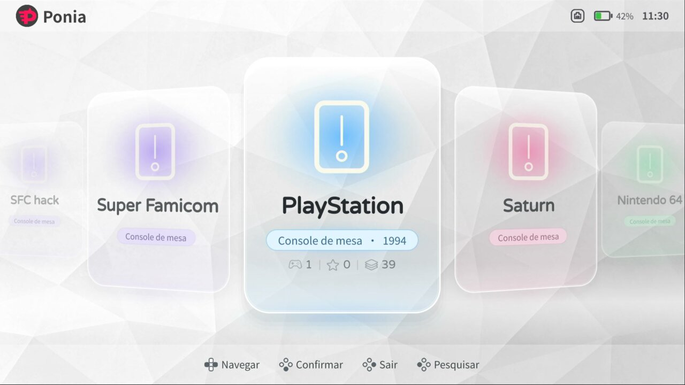

[Deutsch](README.de.md) · [English](README.md) · [Español](README.es.md) · [Français](README.fr.md) · [日本語](README.ja.md) · [Português](README.pt.md) · [Русский](README.ru.md) · [繁體中文](README.zh-TW.md) · [简体中文](README.zh-CN.md)

# PoniaEmu

**Um lançador de jogos com o seu próprio reprodutor de emuladores integrado. Não precisa do RetroArch.**



O PoniaEmu é uma versão modificada do [Pegasus Frontend](https://github.com/mmatyas/pegasus-frontend), portada para o Qt 6 e
combinada com o **PoniaPlay**, um pequeno reprodutor Libretro escrito do zero. O Pegasus fornece a biblioteca de jogos e a
interface (**PoniaFE**); o PoniaPlay carrega diretamente os núcleos Libretro (arquivos `.so`). Juntos, formam um único aplicativo
independente, capaz de rodar mais de uma dúzia de sistemas retrô sem instalar o RetroArch nem qualquer outro aplicativo de emulador.

- **PoniaFE**: o frontend. O Pegasus Frontend portado para o Qt 6, com a marca Ponia, o tema Macaron e uma interface em nove idiomas.
- **PoniaPlay**: o reprodutor integrado. Um host Libretro (`src/libretro-host`) que executa os núcleos como bibliotecas compartilhadas,
  com renderização OpenGL ES, saída de vídeo sem cópia, atalhos de controle, estados salvos e suporte a ROMs em ZIP/7z.
- **Núcleos**: arquivos `.so` comuns do Libretro. Os núcleos pequenos e de licença permissiva vêm incluídos; os demais são baixados
  na primeira vez que você abre um jogo que precisa deles.

A interface está disponível em nove idiomas: English, 简体中文, 繁體中文, Español, Português, Русский, 日本語, Français e Deutsch.

## Sistemas compatíveis

| Sistema | Núcleo |
| --- | --- |
| Nintendo Entertainment System / Famicom | FCEUmm |
| Game Boy / Game Boy Color | Gambatte |
| Game Boy Advance | mGBA |
| Nintendo DS | melonDS |
| Super Nintendo / Super Famicom | Snes9x |
| Nintendo 64 | Mupen64Plus-Next |
| Nintendo GameCube (somente 64 bits) | Dolphin |
| Sega Genesis / Mega Drive, Master System | Genesis Plus GX |
| Sega Saturn | YabaSanshiro |
| Sega Dreamcast | Flycast |
| NEC PC Engine / TurboGrafx-16 | Mednafen PCE Fast |
| Sony PlayStation | PCSX ReARMed |
| Sony PSP | PPSSPP |
| Neo Geo, CPS-1, CPS-2 e outros conjuntos de arcade do FBNeo | FBNeo |
| Arcade (MAME) | MAME, MAME 2003-Plus |
| Atari 2600 | Stella |
| Atari 5200 | a5200 |
| Atari 7800 | ProSystem |
| PICO-8 | fake-08, retro8 |
| Apple II | AppleWin |
| DOS | DOSBox Pure |

Observações:

- **Não são incluídos jogos nem arquivos de BIOS.** Use as suas próprias ROMs, obtidas legalmente. Alguns sistemas (por exemplo, o Sega Saturn)
  precisam de um arquivo de BIOS, que vai na pasta `BIOS` ao lado das suas ROMs.
- Os núcleos com licença não comercial (Snes9x, Genesis Plus GX, FBNeo, MAME 2003-Plus) nunca são incluídos no pacote.
  O PoniaEmu oferece baixá-los no primeiro uso.
- Os atalhos, o mapeamento de botões e o menu de pausa funcionam da mesma forma em todos os sistemas, porque são tratados pelo PoniaPlay.

## Plataformas compatíveis

| Plataforma | Arquiteturas | Observações |
| --- | --- | --- |
| Android | ARM de 64 bits (`arm64-v8a`), ARM de 32 bits (`armeabi-v7a`) | Android 6.0 (API 23) ou mais recente. Funciona com tela sensível ao toque, controle ou controle remoto de TV. |
| Linux | x86_64 (PC de 64 bits), ARM de 64 bits (`arm64`), ARM de 32 bits (`armhf`) | Roda em X11, Wayland ou diretamente no framebuffer (KMS/DRM). O executável `poniaplay` é instalado junto com o frontend. |

O núcleo do GameCube não está disponível em ARM de 32 bits, porque o Dolphin não tem JIT para ARM32.

## Controles

O PoniaEmu sempre trata o controle como um [controle estilo Xbox](doc/img/pad-xbox-style.png), não importa o que esteja impresso nos botões:
o botão de baixo é **A**, o da direita é **B**, o da esquerda é **X** e o de cima é **Y**.

A **tecla de atalho** é o botão **SELECT**. Segure-a e pressione outro botão:

| Combinação | Ação |
| --- | --- |
| Atalho + START | Sair do jogo |
| Atalho + R1 (gatilho superior direito) | Salvar um estado |
| Atalho + L1 (gatilho superior esquerdo) | Carregar um estado |
| Atalho + X (esquerda) | Alternar a resolução de 1X a 4X, em ciclo |
| Atalho + Y (cima) | Mostrar ou ocultar os FPS |
| Atalho + R2 | Avanço rápido |
| Atalho + L2 | Retroceder |

## Compilação

O PoniaEmu usa CMake. Você precisa de um compilador C++17, CMake 3.16 ou mais recente, Ninja e Qt **6.4 ou mais recente** (Qt Quick, Qt Quick
Controls 2, Qt 5 Compatibility, Qt Multimedia, Qt Shader Tools), além do SDL2. O Qt 6.4.2 é a versão usada no desenvolvimento.

### Linux

```sh
git clone https://github.com/ponia2026/PoniaEmu.git
cd PoniaEmu
cmake -S . -B build -G Ninja -DCMAKE_BUILD_TYPE=Release
cmake --build build
sudo cmake --install build
```

Opções úteis:

| Opção | Padrão | Significado |
| --- | --- | --- |
| `PEGASUS_USE_SDL2_GAMEPAD` | `ON` | Usar o SDL2 para a entrada do controle. |
| `PEGASUS_USE_SDL2_POWER` | `ON` (`OFF` no Android) | Usar o SDL2 para informações da bateria. |
| `PEGASUS_ENABLE_LTO` | `ON` | Otimização em tempo de link (compila mais devagar, executa mais rápido). |
| `PEGASUS_STATIC_CXX` | `OFF` | Vincular o runtime do C++ de forma estática. |

Para ARM (`arm64` ou `armhf`), configure da mesma forma com um arquivo de toolchain de compilação cruzada para o destino, ou compile no próprio dispositivo.

### Android

Você precisa do kit Android do Qt 6.4.2 para cada ABI desejada (instalável com o `aqtinstall`), Android NDK r25.1.8937393,
a plataforma 33 do SDK do Android com build-tools 33.0.2, JDK 17 e o SDL2 (2.30.x) compilado para a mesma ABI.
O Qt para desktop da mesma versão deve estar instalado na máquina de compilação (ele fornece `moc` e `rcc`).

```sh
export JAVA_HOME=/path/to/jdk17 ANDROID_HOME=/path/to/android-sdk
QT=/path/to/Qt/6.4.2/android_arm64_v8a      # use android_armv7 para 32 bits

# 1. Obter os núcleos Libretro incluídos (para 32 bits use ABI=armeabi-v7a e informe a pasta de saída correspondente)
etc/android/fetch-bundled-cores.sh

# 2. Configurar e compilar o APK
cmake -S . -B build-android -G Ninja \
  -DCMAKE_TOOLCHAIN_FILE=$QT/lib/cmake/Qt6/qt.toolchain.cmake \
  -DQT_HOST_PATH=/usr \
  -DANDROID_ABI=arm64-v8a -DANDROID_PLATFORM=android-23 \
  -DSDL2_DIR=/path/to/sdl2-arm64/lib/cmake/SDL2 \
  -DCMAKE_FIND_ROOT_PATH=/path/to/sdl2-arm64
cmake --build build-android --target poniaemu_make_apk

# 3. Opcional: reduzir, realinhar e assinar novamente o APK
etc/android/repack-apk.sh <in.apk> <out.apk>
```

O `etc/android/apk-name.sh` mostra o nome do arquivo de uma compilação, no formato `PoniaEmu_v<versão>-<data>(<commit>).apk`.
O núcleo de PICO-8 `fake-08` não tem binário pré-compilado para Android; os comentários em `fetch-bundled-cores.sh` explicam como compilá-lo.

## Licença e direitos autorais

Copyright (C) 2026 Equuleus Works.

- O **PoniaFE** (o frontend) é uma obra derivada do Pegasus Frontend, Copyright (C) 2017-2020 Mátyás Mustoha, e é distribuído sob a
  **Licença Pública Geral GNU v3.0 ou posterior**, com os termos suplementares em [`LICENSE.md`](LICENSE.md).
  Os avisos de direitos autorais dos arquivos-fonte originais são mantidos, como a licença exige.
- O **PoniaPlay** (`src/libretro-host`) foi escrito do zero e é distribuído sob a **GPL-2.0-or-later**, para poder carregar
  tanto núcleos Libretro somente GPLv2 quanto GPLv3. Ele só se comunica com o frontend por argumentos de linha de comando
  e Intents do Android. O `libretro.h` tem licença MIT, Copyright (C) 2010-2020 The RetroArch team.
- Os **núcleos Libretro** são obras separadas, com suas próprias licenças. Só são incluídos os núcleos cujas licenças permitem
  a distribuição comercial.
- O nome “Ponia” e o logotipo da Ponia são propriedade da Equuleus Works. Veja os termos de marca em `LICENSE.md`.
- As demais marcas, nomes de produtos e logotipos pertencem aos seus respectivos donos e são usados apenas para identificação.
  Este projeto é independente e não é afiliado nem endossado pelos autores do Pegasus Frontend.

A lista completa de componentes e licenças de terceiros está em [`NOTICE.md`](NOTICE.md).

## Agradecimentos

O PoniaEmu se apoia em muitos projetos de código aberto. Obrigado a:

- [Pegasus Frontend](https://github.com/mmatyas/pegasus-frontend), de Mátyás Mustoha e colaboradores, a base do frontend.
- [Libretro](https://github.com/libretro) e [RetroArch](https://github.com/libretro/RetroArch), pela API do Libretro
  e pelo ecossistema de núcleos.
- Os autores e mantenedores dos núcleos:
  [FCEUmm](https://github.com/libretro/libretro-fceumm),
  [Gambatte](https://github.com/libretro/gambatte-libretro),
  [mGBA](https://github.com/mgba-emu/mgba),
  [melonDS](https://github.com/libretro/melonDS),
  [Snes9x](https://github.com/snes9xgit/snes9x),
  [Mupen64Plus-Next](https://github.com/libretro/mupen64plus-libretro-nx),
  [Dolphin](https://github.com/libretro/dolphin),
  [Genesis Plus GX](https://github.com/libretro/Genesis-Plus-GX),
  [YabaSanshiro](https://github.com/libretro/yabause),
  [Flycast](https://github.com/flyinghead/flycast),
  [Mednafen PCE Fast](https://github.com/libretro/beetle-pce-fast-libretro),
  [PCSX ReARMed](https://github.com/libretro/pcsx_rearmed),
  [PPSSPP](https://github.com/hrydgard/ppsspp),
  [FBNeo](https://github.com/libretro/FBNeo),
  [MAME](https://github.com/libretro/mame) e [MAME 2003-Plus](https://github.com/libretro/mame2003-plus-libretro),
  [Stella](https://github.com/stella-emu/stella),
  [a5200](https://github.com/libretro/a5200),
  [ProSystem](https://github.com/libretro/prosystem-libretro),
  [fake-08](https://github.com/jtothebell/fake-08),
  [retro8](https://github.com/libretro/retro8),
  [AppleWin](https://github.com/libretro/libretro-applewin) e
  [DOSBox Pure](https://github.com/schellingb/dosbox-pure).
- [Qt](https://www.qt.io/) e [SDL2](https://www.libsdl.org/).
- As fontes [Noto Sans](https://github.com/notofonts) e [Varela Round](https://fonts.google.com/specimen/Varela+Round)
  (SIL Open Font License 1.1) e Roboto (Apache License 2.0).
