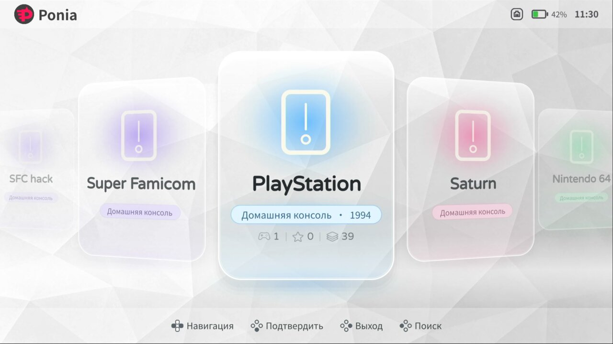

[Deutsch](README.de.md) · [English](README.md) · [Español](README.es.md) · [Français](README.fr.md) · [日本語](README.ja.md) · [Português](README.pt.md) · [Русский](README.ru.md) · [繁體中文](README.zh-TW.md) · [简体中文](README.zh-CN.md)

# PoniaEmu

**Лаунчер игр со встроенным проигрывателем эмуляторов. RetroArch не нужен.**



PoniaEmu — это изменённая версия [Pegasus Frontend](https://github.com/mmatyas/pegasus-frontend), перенесённая на Qt 6 и
объединённая с **PoniaPlay** — небольшим проигрывателем Libretro, написанным с нуля. Pegasus отвечает за библиотеку игр и
интерфейс (**PoniaFE**), а PoniaPlay напрямую загружает ядра Libretro (файлы `.so`). Вместе они образуют одно самостоятельное
приложение, которое запускает больше десятка ретро-систем без установки RetroArch или другого приложения-эмулятора.

- **PoniaFE**: фронтенд. Pegasus Frontend, перенесённый на Qt 6, с оформлением Ponia, темой Macaron и интерфейсом на девяти языках.
- **PoniaPlay**: встроенный проигрыватель. Хост Libretro (`src/libretro-host`), который запускает ядра как динамические библиотеки,
  с отрисовкой через OpenGL ES, выводом видео без копирования, горячими клавишами геймпада, сохранениями состояния и поддержкой ROM в ZIP/7z.
- **Ядра**: обычные файлы `.so` для Libretro. Небольшие ядра со свободной лицензией входят в комплект, остальные скачиваются
  при первом запуске игры, которой они нужны.

Интерфейс доступен на девяти языках: English, 简体中文, 繁體中文, Español, Português, Русский, 日本語, Français и Deutsch.

## Поддерживаемые системы

| Система | Ядро |
| --- | --- |
| Nintendo Entertainment System / Famicom | FCEUmm |
| Game Boy / Game Boy Color | Gambatte |
| Game Boy Advance | mGBA |
| Nintendo DS | melonDS |
| Super Nintendo / Super Famicom | Snes9x |
| Nintendo 64 | Mupen64Plus-Next |
| Nintendo GameCube (только 64 бит) | Dolphin |
| Sega Genesis / Mega Drive, Master System | Genesis Plus GX |
| Sega Saturn | YabaSanshiro |
| Sega Dreamcast | Flycast |
| NEC PC Engine / TurboGrafx-16 | Mednafen PCE Fast |
| Sony PlayStation | PCSX ReARMed |
| Sony PSP | PPSSPP |
| Neo Geo, CPS-1, CPS-2 и другие аркадные наборы FBNeo | FBNeo |
| Аркады (MAME) | MAME, MAME 2003-Plus |
| Atari 2600 | Stella |
| Atari 5200 | a5200 |
| Atari 7800 | ProSystem |
| PICO-8 | fake-08, retro8 |
| Apple II | AppleWin |
| DOS | DOSBox Pure |

Примечания:

- **Игры и файлы BIOS не входят в комплект.** Используйте собственные ROM, полученные законным путём. Некоторым системам (например, Sega Saturn)
  нужен файл BIOS — его кладут в папку `BIOS` рядом с ROM.
- Ядра с некоммерческой лицензией (Snes9x, Genesis Plus GX, FBNeo, MAME 2003-Plus) никогда не входят в пакет.
  PoniaEmu предложит скачать их при первом использовании.
- Горячие клавиши, раскладка кнопок и меню паузы работают одинаково во всех системах, потому что ими управляет PoniaPlay.

## Поддерживаемые платформы

| Платформа | Архитектуры | Примечания |
| --- | --- | --- |
| Android | 64 бит (`arm64-v8a`), 32 бит (`armeabi-v7a`) | Android 6.0 (API 23) или новее. Работает с сенсорным экраном, геймпадом и пультом от ТВ. |
| Linux | 64 бит, 32 бит | Работает в X11, Wayland или прямо на фреймбуфере (KMS/DRM). Исполняемый файл `poniaplay` устанавливается рядом с фронтендом. |

Ядро GameCube недоступно на 32-битном ARM, потому что у Dolphin нет JIT для ARM32.

## Управление

PoniaEmu всегда считает геймпад [геймпадом в стиле Xbox](doc/img/pad-xbox-style.png), что бы ни было напечатано на кнопках:
нижняя кнопка — **A**, правая — **B**, левая — **X**, верхняя — **Y**.

**Горячая клавиша** — кнопка **SELECT**. Удерживайте её и нажмите другую кнопку:

| Комбинация | Действие |
| --- | --- |
| Горячая клавиша + START | Выйти из игры |
| Горячая клавиша + R1 (правый бампер) | Сохранить состояние |
| Горячая клавиша + L1 (левый бампер) | Загрузить состояние |
| Горячая клавиша + X (слева) | Переключать разрешение по кругу, от 1X до 4X |
| Горячая клавиша + Y (сверху) | Показать или скрыть счётчик FPS |
| Горячая клавиша + R2 | Перемотка вперёд |
| Горячая клавиша + L2 | Перемотка назад |

## Сборка

PoniaEmu использует CMake. Нужны компилятор C++17, CMake 3.16 или новее, Ninja и Qt **6.4 или новее** (Qt Quick, Qt Quick
Controls 2, Qt 5 Compatibility, Qt Multimedia, Qt Shader Tools), а также SDL2. Для разработки используется Qt 6.4.2.

### Linux

```sh
git clone https://github.com/ponia2026/PoniaEmu.git
cd PoniaEmu
cmake -S . -B build -G Ninja -DCMAKE_BUILD_TYPE=Release
cmake --build build
sudo cmake --install build
```

Полезные параметры:

| Параметр | По умолчанию | Значение |
| --- | --- | --- |
| `PEGASUS_USE_SDL2_GAMEPAD` | `ON` | Использовать SDL2 для ввода с геймпада. |
| `PEGASUS_USE_SDL2_POWER` | `ON` (`OFF` в Android) | Использовать SDL2 для сведений о батарее. |
| `PEGASUS_ENABLE_LTO` | `ON` | Оптимизация на этапе компоновки (собирается дольше, работает быстрее). |
| `PEGASUS_STATIC_CXX` | `OFF` | Статически подключать среду выполнения C++. |

Для 32-битной сборки под Linux настройте проект так же, но с 32-битным набором инструментов (или на 32-битной системе).

### Android

Нужны Android-комплект Qt 6.4.2 для каждой нужной ABI (устанавливается через `aqtinstall`), Android NDK r25.1.8937393,
платформа Android SDK 33 с build-tools 33.0.2, JDK 17 и SDL2 (2.30.x), собранный для той же ABI.
На машине для сборки должен быть установлен настольный Qt той же версии (он даёт `moc` и `rcc`).

```sh
export JAVA_HOME=/path/to/jdk17 ANDROID_HOME=/path/to/android-sdk
QT=/path/to/Qt/6.4.2/android_arm64_v8a      # для 32 бит используйте android_armv7

# 1. Получить встроенные ядра Libretro (для 32 бит задайте ABI=armeabi-v7a и укажите соответствующую папку вывода)
etc/android/fetch-bundled-cores.sh

# 2. Настроить проект и собрать APK
cmake -S . -B build-android -G Ninja \
  -DCMAKE_TOOLCHAIN_FILE=$QT/lib/cmake/Qt6/qt.toolchain.cmake \
  -DQT_HOST_PATH=/usr \
  -DANDROID_ABI=arm64-v8a -DANDROID_PLATFORM=android-23 \
  -DSDL2_DIR=/path/to/sdl2-arm64/lib/cmake/SDL2 \
  -DCMAKE_FIND_ROOT_PATH=/path/to/sdl2-arm64
cmake --build build-android --target poniafe_make_apk

# 3. По желанию: уменьшить APK, выровнять и подписать заново
etc/android/repack-apk.sh <in.apk> <out.apk>
```

`etc/android/apk-name.sh` выводит имя файла для сборки в виде `PoniaEmu_v<версия>-<дата>(<коммит>).apk`.
Для ядра PICO-8 `fake-08` нет готового бинарного файла для Android; как его собрать, объясняют комментарии в `fetch-bundled-cores.sh`.

## Лицензия и авторские права

Copyright (C) 2026 Equuleus Works.

- **PoniaFE** (фронтенд) — производная работа от Pegasus Frontend, Copyright (C) 2017-2020 Mátyás Mustoha, и распространяется по
  **Универсальной общественной лицензии GNU версии 3.0 или более поздней** с дополнительными условиями из [`LICENSE.md`](LICENSE.md).
  Уведомления об авторских правах в исходных файлах сохранены, как требует лицензия.
- **PoniaPlay** (`src/libretro-host`) написан с нуля и распространяется по **GPL-2.0-or-later**, чтобы загружать
  и ядра Libretro только под GPLv2, и ядра под GPLv3. С фронтендом он обменивается данными только через аргументы командной строки
  и Intent-ы Android. `libretro.h` распространяется по лицензии MIT, Copyright (C) 2010-2020 The RetroArch team.
- **Ядра Libretro** — отдельные произведения со своими лицензиями. В комплект входят только ядра, лицензии которых разрешают
  коммерческое распространение.
- Название «Ponia» и логотип Ponia принадлежат Equuleus Works. Условия использования товарного знака см. в `LICENSE.md`.
- Все остальные товарные знаки, названия продуктов и логотипы принадлежат их владельцам и используются только для идентификации.
  Проект независим и не связан с авторами Pegasus Frontend и не одобрен ими.

Полный список сторонних компонентов и лицензий находится в [`NOTICE.md`](NOTICE.md).

## Благодарности

PoniaEmu опирается на множество проектов с открытым исходным кодом. Спасибо:

- [Pegasus Frontend](https://github.com/mmatyas/pegasus-frontend), Mátyás Mustoha и участникам проекта — основа фронтенда.
- [Libretro](https://github.com/libretro) и [RetroArch](https://github.com/libretro/RetroArch) за API Libretro
  и экосистему ядер.
- Авторам и сопровождающим ядер:
  [FCEUmm](https://github.com/libretro/libretro-fceumm),
  [Gambatte](https://github.com/libretro/gambatte-libretro),
  [mGBA](https://github.com/mgba-emu/mgba),
  [melonDS](https://github.com/libretro/melonDS),
  [Snes9x](https://github.com/snes9xgit/snes9x),
  [Mupen64Plus-Next](https://github.com/libretro/mupen64plus-libretro-nx),
  [Dolphin](https://github.com/libretro/dolphin),
  [Genesis Plus GX](https://github.com/libretro/Genesis-Plus-GX),
  [YabaSanshiro](https://github.com/libretro/yabause),
  [Flycast](https://github.com/flyinghead/flycast),
  [Mednafen PCE Fast](https://github.com/libretro/beetle-pce-fast-libretro),
  [PCSX ReARMed](https://github.com/libretro/pcsx_rearmed),
  [PPSSPP](https://github.com/hrydgard/ppsspp),
  [FBNeo](https://github.com/libretro/FBNeo),
  [MAME](https://github.com/libretro/mame) и [MAME 2003-Plus](https://github.com/libretro/mame2003-plus-libretro),
  [Stella](https://github.com/stella-emu/stella),
  [a5200](https://github.com/libretro/a5200),
  [ProSystem](https://github.com/libretro/prosystem-libretro),
  [fake-08](https://github.com/jtothebell/fake-08),
  [retro8](https://github.com/libretro/retro8),
  [AppleWin](https://github.com/libretro/libretro-applewin) и
  [DOSBox Pure](https://github.com/schellingb/dosbox-pure).
- [Qt](https://www.qt.io/) и [SDL2](https://www.libsdl.org/).
- Шрифтам [Noto Sans](https://github.com/notofonts) и [Varela Round](https://fonts.google.com/specimen/Varela+Round)
  (SIL Open Font License 1.1) и Roboto (Apache License 2.0).
