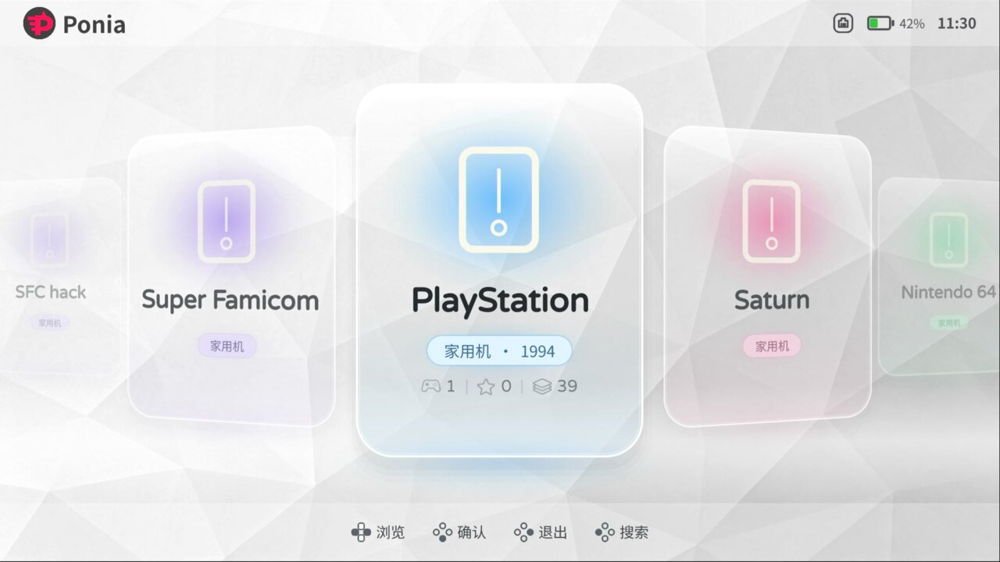

[Deutsch](README.de.md) · [English](README.md) · [Español](README.es.md) · [Français](README.fr.md) · [日本語](README.ja.md) · [Português](README.pt.md) · [Русский](README.ru.md) · [繁體中文](README.zh-TW.md) · [简体中文](README.zh-CN.md)

# PoniaEmu

**内置模拟器播放功能的游戏启动器，不需要 RetroArch。**



PoniaEmu 是 [Pegasus Frontend](https://github.com/mmatyas/pegasus-frontend)（天马前端）的修改版，已移植到 Qt 6，
并加上从零写起的小型 Libretro 播放器 **PoniaPlay**。Pegasus 负责游戏库和界面（**PoniaFE**），PoniaPlay 则直接加载
Libretro 核心（`.so` 文件）。两者合在一起就是一个独立的应用程序，不必安装 RetroArch 或其他模拟器 App，
就能玩十几种复古主机。

- **PoniaFE**：前端。移植到 Qt 6 的 Pegasus Frontend，换上 Ponia 品牌、Macaron 主题，界面支持九种语言。
- **PoniaPlay**：内置播放器。这是一个 Libretro 宿主（`src/libretro-host`），以共享库的方式运行核心，
  支持 OpenGL ES 绘制、零拷贝视频输出、手柄热键、即时存档，以及 ZIP/7z 压缩的 ROM。
- **核心**：普通的 Libretro `.so` 文件。体积小、授权宽松的核心直接附在安装包里，其余的核心会在你第一次启动
  需要它的游戏时才下载。

界面支持九种语言：English、简体中文、繁體中文、Español、Português、Русский、日本語、Français、Deutsch。

## 支持的机种

| 机种 | 核心 |
| --- | --- |
| 任天堂 FC / Famicom | FCEUmm |
| Game Boy / Game Boy Color | Gambatte |
| Game Boy Advance | mGBA |
| 任天堂 DS | melonDS |
| 超级任天堂 / Super Famicom | Snes9x |
| 任天堂 64 | Mupen64Plus-Next |
| 任天堂 GameCube（仅 64 位） | Dolphin |
| Sega Genesis / Mega Drive、Master System | Genesis Plus GX |
| Sega Saturn | YabaSanshiro |
| Sega Dreamcast | Flycast |
| NEC PC Engine / TurboGrafx-16 | Mednafen PCE Fast |
| Sony PlayStation | PCSX ReARMed |
| Sony PSP | PPSSPP |
| Neo Geo、CPS-1、CPS-2 等 FBNeo 街机 | FBNeo |
| 街机（MAME） | MAME, MAME 2003-Plus |
| Atari 2600 | Stella |
| Atari 5200 | a5200 |
| Atari 7800 | ProSystem |
| PICO-8 | fake-08, retro8 |
| Apple II | AppleWin |
| DOS | DOSBox Pure |

注意事项：

- **不附带任何游戏或 BIOS 文件。** 请使用你自己合法获得的 ROM。部分机种（例如 Sega Saturn）需要 BIOS 文件，
  放在 ROM 旁边的 `BIOS` 文件夹即可。
- 授权为非商用的核心（Snes9x、Genesis Plus GX、FBNeo、MAME 2003-Plus）不会放进安装包，
  第一次使用时 PoniaEmu 会询问是否下载。
- 热键、按键配置和暂停菜单由 PoniaPlay 统一处理，所以每个机种的操作方式都一样。

## 支持的平台

| 平台 | 架构 | 备注 |
| --- | --- | --- |
| Android | 64 位（`arm64-v8a`）、32 位（`armeabi-v7a`） | Android 6.0（API 23）以上。可用触控屏、手柄或电视遥控器操作。 |
| Linux | 64 位、32 位 | 可在 X11、Wayland 下运行，也能直接跑在 framebuffer（KMS/DRM）上。`poniaplay` 可执行文件会安装在前端旁边。 |

GameCube 核心不支持 32 位 ARM，因为 Dolphin 没有 ARM32 的 JIT。

## 编译

PoniaEmu 使用 CMake。你需要 C++17 编译器、CMake 3.16 以上、Ninja，以及 Qt **6.4 以上**（Qt Quick、Qt Quick
Controls 2、Qt 5 Compatibility、Qt Multimedia、Qt Shader Tools），还有 SDL2。开发时使用的是 Qt 6.4.2。

### Linux

```sh
git clone https://github.com/ponia2026/PoniaEmu.git
cd PoniaEmu
cmake -S . -B build -G Ninja -DCMAKE_BUILD_TYPE=Release
cmake --build build
sudo cmake --install build
```

常用选项：

| 选项 | 默认值 | 说明 |
| --- | --- | --- |
| `PEGASUS_USE_SDL2_GAMEPAD` | `ON` | 用 SDL2 处理手柄输入。 |
| `PEGASUS_USE_SDL2_POWER` | `ON`（Android 为 `OFF`） | 用 SDL2 获取电池信息。 |
| `PEGASUS_ENABLE_LTO` | `ON` | 链接时优化（编译较慢，运行较快）。 |
| `PEGASUS_STATIC_CXX` | `OFF` | 以静态方式链接 C++ 运行时。 |

要编 32 位 Linux 版，配置方式相同，改用 32 位工具链（或在 32 位系统上编译）。

### Android

你需要每个目标 ABI 对应的 Qt 6.4.2 Android 套件（可用 `aqtinstall` 安装）、Android NDK r25.1.8937393、
Android SDK platform 33 加 build-tools 33.0.2、JDK 17，以及为同一个 ABI 编好的 SDL2（2.30.x）。
编译用的电脑上还要装同版本的 Qt 桌面版（它提供 `moc` 和 `rcc`）。

```sh
export JAVA_HOME=/path/to/jdk17 ANDROID_HOME=/path/to/android-sdk
QT=/path/to/Qt/6.4.2/android_arm64_v8a      # 32 位请改用 android_armv7

# 1. 获取随包附带的 Libretro 核心（32 位请设 ABI=armeabi-v7a，并指定对应的输出文件夹）
etc/android/fetch-bundled-cores.sh

# 2. 配置并编出 APK
cmake -S . -B build-android -G Ninja \
  -DCMAKE_TOOLCHAIN_FILE=$QT/lib/cmake/Qt6/qt.toolchain.cmake \
  -DQT_HOST_PATH=/usr \
  -DANDROID_ABI=arm64-v8a -DANDROID_PLATFORM=android-23 \
  -DSDL2_DIR=/path/to/sdl2-arm64/lib/cmake/SDL2 \
  -DCMAKE_FIND_ROOT_PATH=/path/to/sdl2-arm64
cmake --build build-android --target poniafe_make_apk

# 3. 可选：缩小 APK、重新对齐并重新签名
etc/android/repack-apk.sh <in.apk> <out.apk>
```

`etc/android/apk-name.sh` 会打印这次编译的文件名，格式是 `PoniaEmu_v<版本>-<日期>(<提交号>).apk`。
PICO-8 核心 `fake-08` 没有现成的 Android 可执行文件，编译方式写在 `fetch-bundled-cores.sh` 的注释里。

## 授权与版权

Copyright (C) 2026 Equuleus Works.

- **PoniaFE**（前端）是 Pegasus Frontend 的衍生作品，原作 Copyright (C) 2017-2020 Mátyás Mustoha，
  依 **GNU General Public License v3.0 或更新版本**发布，补充条款见 [`LICENSE.md`](LICENSE.md)。
  依授权要求，源代码文件中的原作者版权声明一律保留。
- **PoniaPlay**（`src/libretro-host`）从零写成，采用 **GPL-2.0-or-later**，因此能同时加载仅限 GPLv2 与 GPLv3 的
  Libretro 核心。它与前端之间只通过命令行参数和 Android Intent 沟通。`libretro.h` 为 MIT 授权，
  Copyright (C) 2010-2020 The RetroArch team。
- **Libretro 核心**是各自独立的作品，有自己的授权。安装包只内置授权允许商业发布的核心。
- “Ponia”名称与 Ponia 标志为 Equuleus Works 所有，商标条款见 `LICENSE.md`。
- 其他商标、产品名称和标志属于各自的所有人，仅用于识别。本项目为独立项目，
  与 Pegasus Frontend 作者无关，也未获其背书。

第三方组件与授权的完整清单见 [`NOTICE.md`](NOTICE.md)。

## 致谢

PoniaEmu 站在许多开源项目的肩膀上，特别感谢：

- [Pegasus Frontend](https://github.com/mmatyas/pegasus-frontend)，Mátyás Mustoha 与所有贡献者，是前端的基础。
- [Libretro](https://github.com/libretro) 与 [RetroArch](https://github.com/libretro/RetroArch)，提供 Libretro API
  与核心生态。
- 各核心的作者与维护者：
  [FCEUmm](https://github.com/libretro/libretro-fceumm)、
  [Gambatte](https://github.com/libretro/gambatte-libretro)、
  [mGBA](https://github.com/mgba-emu/mgba)、
  [melonDS](https://github.com/libretro/melonDS)、
  [Snes9x](https://github.com/snes9xgit/snes9x)、
  [Mupen64Plus-Next](https://github.com/libretro/mupen64plus-libretro-nx)、
  [Dolphin](https://github.com/libretro/dolphin)、
  [Genesis Plus GX](https://github.com/libretro/Genesis-Plus-GX)、
  [YabaSanshiro](https://github.com/libretro/yabause)、
  [Flycast](https://github.com/flyinghead/flycast)、
  [Mednafen PCE Fast](https://github.com/libretro/beetle-pce-fast-libretro)、
  [PCSX ReARMed](https://github.com/libretro/pcsx_rearmed)、
  [PPSSPP](https://github.com/hrydgard/ppsspp)、
  [FBNeo](https://github.com/libretro/FBNeo)、
  [MAME](https://github.com/libretro/mame) 与 [MAME 2003-Plus](https://github.com/libretro/mame2003-plus-libretro)、
  [Stella](https://github.com/stella-emu/stella)、
  [a5200](https://github.com/libretro/a5200)、
  [ProSystem](https://github.com/libretro/prosystem-libretro)、
  [fake-08](https://github.com/jtothebell/fake-08)、
  [retro8](https://github.com/libretro/retro8)、
  [AppleWin](https://github.com/libretro/libretro-applewin)、
  [DOSBox Pure](https://github.com/schellingb/dosbox-pure)。
- [Qt](https://www.qt.io/) 与 [SDL2](https://www.libsdl.org/)。
- [Noto Sans](https://github.com/notofonts) 与 [Varela Round](https://fonts.google.com/specimen/Varela+Round) 字体
  （SIL Open Font License 1.1），以及 Roboto 字体（Apache License 2.0）。
