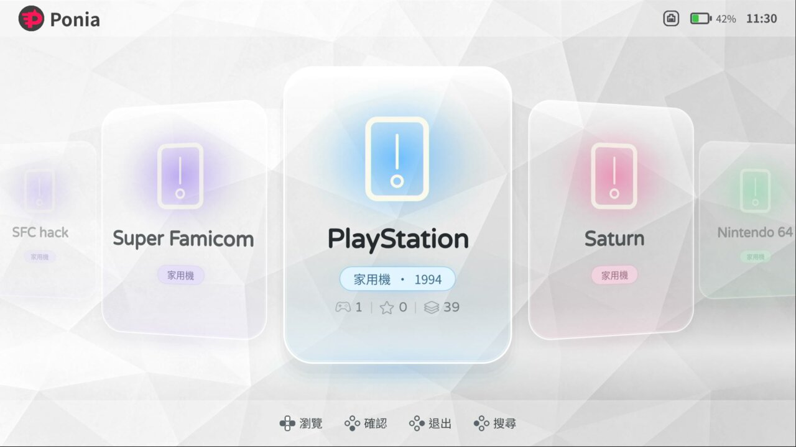

[Deutsch](README.de.md) · [English](README.md) · [Español](README.es.md) · [Français](README.fr.md) · [日本語](README.ja.md) · [Português](README.pt.md) · [Русский](README.ru.md) · [繁體中文](README.zh-TW.md) · [简体中文](README.zh-CN.md)

# PoniaEmu

**內建模擬器播放功能的遊戲啟動器，不需要 RetroArch。**



PoniaEmu 是 [Pegasus Frontend](https://github.com/mmatyas/pegasus-frontend)（天馬前端）的修改版，已移植到 Qt 6，
並加上從零寫起的小型 Libretro 播放器 **PoniaPlay**。Pegasus 負責遊戲庫和介面（**PoniaFE**），PoniaPlay 則直接載入
Libretro 核心（`.so` 檔）。兩者合在一起就是一個獨立的應用程式，不必安裝 RetroArch 或其他模擬器 App，
就能玩十幾種復古主機。

- **PoniaFE**：前端。移植到 Qt 6 的 Pegasus Frontend，換上 Ponia 品牌、Macaron 主題，介面支援九種語言。
- **PoniaPlay**：內建播放器。這是一個 Libretro 宿主（`src/libretro-host`），以共用函式庫的方式執行核心，
  支援 OpenGL ES 繪圖、零拷貝影像輸出、手把熱鍵、即時存檔，以及 ZIP/7z 壓縮的 ROM。
- **核心**：一般的 Libretro `.so` 檔。體積小、授權寬鬆的核心直接附在安裝包裡，其餘的核心會在你第一次啟動
  需要它的遊戲時才下載。

介面支援九種語言：English、简体中文、繁體中文、Español、Português、Русский、日本語、Français、Deutsch。

## 支援的機種

| 機種 | 核心 |
| --- | --- |
| 任天堂 FC / Famicom | FCEUmm |
| Game Boy / Game Boy Color | Gambatte |
| Game Boy Advance | mGBA |
| 任天堂 DS | melonDS |
| 超級任天堂 / Super Famicom | Snes9x |
| 任天堂 64 | Mupen64Plus-Next |
| 任天堂 GameCube（僅 64 位元） | Dolphin |
| Sega Genesis / Mega Drive、Master System | Genesis Plus GX |
| Sega Saturn | YabaSanshiro |
| Sega Dreamcast | Flycast |
| NEC PC Engine / TurboGrafx-16 | Mednafen PCE Fast |
| Sony PlayStation | PCSX ReARMed |
| Sony PSP | PPSSPP |
| Neo Geo、CPS-1、CPS-2 等 FBNeo 街機 | FBNeo |
| 街機（MAME） | MAME, MAME 2003-Plus |
| Atari 2600 | Stella |
| Atari 5200 | a5200 |
| Atari 7800 | ProSystem |
| PICO-8 | fake-08, retro8 |
| Apple II | AppleWin |
| DOS | DOSBox Pure |

注意事項：

- **不附帶任何遊戲或 BIOS 檔。** 請使用你自己合法取得的 ROM。部分機種（例如 Sega Saturn）需要 BIOS 檔，
  放在 ROM 旁邊的 `BIOS` 資料夾即可。
- 授權為非商用的核心（Snes9x、Genesis Plus GX、FBNeo、MAME 2003-Plus）不會放進安裝包，
  第一次使用時 PoniaEmu 會詢問是否下載。
- 熱鍵、按鍵配置和暫停選單由 PoniaPlay 統一處理，所以每個機種的操作方式都一樣。

## 支援的平台

| 平台 | 架構 | 備註 |
| --- | --- | --- |
| Android | ARM 64 位元（`arm64-v8a`）、ARM 32 位元（`armeabi-v7a`） | Android 6.0（API 23）以上。可用觸控螢幕、手把或電視遙控器操作。 |
| Linux | x86_64（64 位元電腦）、ARM 64 位元（`arm64`）、ARM 32 位元（`armhf`） | 可在 X11、Wayland 下執行，也能直接跑在 framebuffer（KMS/DRM）上。`poniaplay` 執行檔會安裝在前端旁邊。 |

GameCube 核心不支援 32 位元 ARM，因為 Dolphin 沒有 ARM32 的 JIT。

## 手把操作

PoniaEmu 一律把手把當成 [Xbox 式手把](doc/img/pad-xbox-style.png)，不管按鍵上印的是什麼字：
下面的鍵是 **A**，右邊是 **B**，左邊是 **X**，上面是 **Y**。

**熱鍵**是 **SELECT** 鍵，按住它再按其他鍵：

| 組合 | 功能 |
| --- | --- |
| 熱鍵 + START | 退出遊戲 |
| 熱鍵 + R1（右肩鍵） | 儲存即時存檔 |
| 熱鍵 + L1（左肩鍵） | 讀取即時存檔 |
| 熱鍵 + X（左） | 切換解析度 1X～4X，循環 |
| 熱鍵 + Y（上） | 切換 FPS 幀率顯示 |
| 熱鍵 + R2 | 快進 |
| 熱鍵 + L2 | 快退 |

## 編譯

PoniaEmu 使用 CMake。你需要 C++17 編譯器、CMake 3.16 以上、Ninja，以及 Qt **6.4 以上**（Qt Quick、Qt Quick
Controls 2、Qt 5 Compatibility、Qt Multimedia、Qt Shader Tools），還有 SDL2。開發時使用的是 Qt 6.4.2。

### Linux

```sh
git clone https://github.com/ponia2026/PoniaEmu.git
cd PoniaEmu
cmake -S . -B build -G Ninja -DCMAKE_BUILD_TYPE=Release
cmake --build build
sudo cmake --install build
```

常用選項：

| 選項 | 預設值 | 說明 |
| --- | --- | --- |
| `PEGASUS_USE_SDL2_GAMEPAD` | `ON` | 用 SDL2 處理手把輸入。 |
| `PEGASUS_USE_SDL2_POWER` | `ON`（Android 為 `OFF`） | 用 SDL2 取得電池資訊。 |
| `PEGASUS_ENABLE_LTO` | `ON` | 連結時最佳化（編譯較慢，執行較快）。 |
| `PEGASUS_STATIC_CXX` | `OFF` | 以靜態方式連結 C++ 執行環境。 |

要編 ARM 版（`arm64` 或 `armhf`），設定方式相同，改用對應目標的交叉編譯工具鏈檔，或直接在裝置上編譯。

### Android

你需要每個目標 ABI 對應的 Qt 6.4.2 Android 套件（可用 `aqtinstall` 安裝）、Android NDK r25.1.8937393、
Android SDK platform 33 加 build-tools 33.0.2、JDK 17，以及為同一個 ABI 編好的 SDL2（2.30.x）。
編譯用的電腦上還要裝同版本的 Qt 桌面版（它提供 `moc` 和 `rcc`）。

```sh
export JAVA_HOME=/path/to/jdk17 ANDROID_HOME=/path/to/android-sdk
QT=/path/to/Qt/6.4.2/android_arm64_v8a      # 32 位元請改用 android_armv7

# 1. 取得隨包附帶的 Libretro 核心（32 位元請設 ABI=armeabi-v7a，並指定對應的輸出資料夾）
etc/android/fetch-bundled-cores.sh

# 2. 設定並編出 APK
cmake -S . -B build-android -G Ninja \
  -DCMAKE_TOOLCHAIN_FILE=$QT/lib/cmake/Qt6/qt.toolchain.cmake \
  -DQT_HOST_PATH=/usr \
  -DANDROID_ABI=arm64-v8a -DANDROID_PLATFORM=android-23 \
  -DSDL2_DIR=/path/to/sdl2-arm64/lib/cmake/SDL2 \
  -DCMAKE_FIND_ROOT_PATH=/path/to/sdl2-arm64
cmake --build build-android --target poniafe_make_apk

# 3. 選用：縮小 APK、重新對齊並重新簽章
etc/android/repack-apk.sh <in.apk> <out.apk>
```

`etc/android/apk-name.sh` 會印出這次編譯的檔名，格式是 `PoniaEmu_v<版本>-<日期>(<提交號>).apk`。
PICO-8 核心 `fake-08` 沒有現成的 Android 執行檔，編譯方式寫在 `fetch-bundled-cores.sh` 的註解裡。

## 授權與版權

Copyright (C) 2026 Equuleus Works.

- **PoniaFE**（前端）是 Pegasus Frontend 的衍生作品，原作 Copyright (C) 2017-2020 Mátyás Mustoha，
  依 **GNU General Public License v3.0 或更新版本**散布，補充條款見 [`LICENSE.md`](LICENSE.md)。
  依授權要求，原始碼檔案中的原作者版權聲明一律保留。
- **PoniaPlay**（`src/libretro-host`）從零寫成，採用 **GPL-2.0-or-later**，因此能同時載入僅限 GPLv2 與 GPLv3 的
  Libretro 核心。它與前端之間只透過命令列參數和 Android Intent 溝通。`libretro.h` 為 MIT 授權，
  Copyright (C) 2010-2020 The RetroArch team。
- **Libretro 核心**是各自獨立的作品，有自己的授權。安裝包只內建授權允許商業散布的核心。
- 「Ponia」名稱與 Ponia 標誌為 Equuleus Works 所有，商標條款見 `LICENSE.md`。
- 其他商標、產品名稱和標誌屬於各自的所有人，僅用於識別。本專案為獨立專案，
  與 Pegasus Frontend 作者無關，也未獲其背書。

第三方元件與授權的完整清單見 [`NOTICE.md`](NOTICE.md)。

## 致謝

PoniaEmu 站在許多開源專案的肩膀上，特別感謝：

- [Pegasus Frontend](https://github.com/mmatyas/pegasus-frontend)，Mátyás Mustoha 與所有貢獻者，是前端的基礎。
- [Libretro](https://github.com/libretro) 與 [RetroArch](https://github.com/libretro/RetroArch)，提供 Libretro API
  與核心生態。
- 各核心的作者與維護者：
  [FCEUmm](https://github.com/libretro/libretro-fceumm)、
  [Gambatte](https://github.com/libretro/gambatte-libretro)、
  [mGBA](https://github.com/mgba-emu/mgba)、
  [melonDS](https://github.com/libretro/melonDS)、
  [Snes9x](https://github.com/snes9xgit/snes9x)、
  [Mupen64Plus-Next](https://github.com/libretro/mupen64plus-libretro-nx)、
  [Dolphin](https://github.com/libretro/dolphin)、
  [Genesis Plus GX](https://github.com/libretro/Genesis-Plus-GX)、
  [YabaSanshiro](https://github.com/libretro/yabause)、
  [Flycast](https://github.com/flyinghead/flycast)、
  [Mednafen PCE Fast](https://github.com/libretro/beetle-pce-fast-libretro)、
  [PCSX ReARMed](https://github.com/libretro/pcsx_rearmed)、
  [PPSSPP](https://github.com/hrydgard/ppsspp)、
  [FBNeo](https://github.com/libretro/FBNeo)、
  [MAME](https://github.com/libretro/mame) 與 [MAME 2003-Plus](https://github.com/libretro/mame2003-plus-libretro)、
  [Stella](https://github.com/stella-emu/stella)、
  [a5200](https://github.com/libretro/a5200)、
  [ProSystem](https://github.com/libretro/prosystem-libretro)、
  [fake-08](https://github.com/jtothebell/fake-08)、
  [retro8](https://github.com/libretro/retro8)、
  [AppleWin](https://github.com/libretro/libretro-applewin)、
  [DOSBox Pure](https://github.com/schellingb/dosbox-pure)。
- [Qt](https://www.qt.io/) 與 [SDL2](https://www.libsdl.org/)。
- [Noto Sans](https://github.com/notofonts) 與 [Varela Round](https://fonts.google.com/specimen/Varela+Round) 字型
  （SIL Open Font License 1.1），以及 Roboto 字型（Apache License 2.0）。
